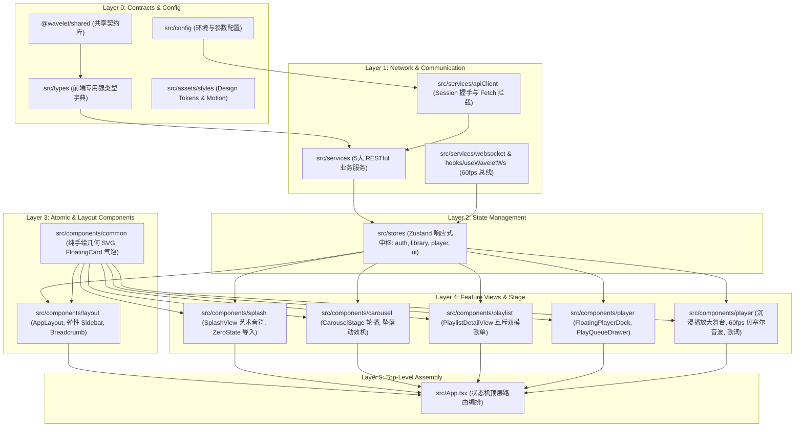

# Wavelet - 前端架构设计与工程拓扑规范

> **规范版本**：v1.0.0  
> **所属阶段**：Phase 1 - 架构与规格定义  
> **关联依据**：[前端设计.md](file:///home/Skualeilu/Projects/Wavelet/documents/前端设计.md) / [前端开发路线.md](file:///home/Skualeilu/Projects/Wavelet/documents/前端开发路线.md)

---

## 1. 架构总览与核心设计原则

Wavelet 前端工程（`@wavelet/frontend`）基于 **React 19 + TypeScript 5.7 + Tailwind CSS v4 + Motion v12 + Zustand v5** 构建，遵循**分层解耦、单向依赖、纯净极简与发烧级性能**的设计原则。



### 核心架构原则

1. **单向分层依赖 (Unidirectional Layering)**：
   - 依赖严格向下流动：`App -> Views -> Components -> Stores -> Services -> Config/Types/Shared`。
   - 绝不允许高层基础设施反向依赖视图组件，绝不允许同一层级模块发生循环引用（Circular Dependency）。
2. **纯净类型安全 (Zero `any`)**：
   - 全量启用 TypeScript 严格模式，所有接口出入参、状态模型、组件 Props 必须具有完备的类型推断。
   - 数据源头严格对齐 `@wavelet/shared`，前端独有展示层类型统一定义在 `src/types/` 中。
3. **隔离数据访问 (Isolated Data Access)**：
   - 视图与 UI 组件严禁直接调用 `fetch` 或直接发起 WebSocket 请求，必须统一通过 `src/services/` 与 `src/stores/` 完成数据流动。
4. **渲染性能与 DOM 节流 (Render Optimization)**：
   - 高频数据（如 60fps 的 64 维 FFT 频谱数据）直接走 `Canvas 2D` 的 `requestAnimationFrame` 管线，严禁频繁触发全局 React DOM 重渲染。
   - 动画采用 `motion/react` 硬件加速变换（`transform: translate3d / scale`），避免触发布局回流（Reflow）。

---

## 2. 工程目录拓扑结构

```
packages/frontend/
├── index.html                      # HTML 模版与根挂载点
├── package.json                    # 前端依赖配置
├── tsconfig.json                   # TypeScript 配置 (继承 tsconfig.base.json)
├── vite.config.ts                  # Vite 构建器配置 (Tailwind v4 插件挂载)
└── src/
    ├── assets/
    │   ├── fonts/
    │   │   └── quicksand.css       # 字体引入与排印配置
    │   └── styles/
    │       ├── tokens.css          # INS 纯白底色、柔和微投影、间距变量
    │       └── motion.ts           # Framer Motion 物理弹簧阻尼预设
    ├── config/
    │   └── index.ts                # 运行时参数配置（API 地址、默认音量、采样率等）
    ├── types/
    │   ├── index.ts                # 统一导出
    │   ├── view.ts                 # 顶层工作流视图路由状态类型
    │   ├── ui.ts                   # 弹簧配置、位置坐标、悬浮气泡类型
    │   └── component.ts            # 通用组件专有属性类型
    ├── services/
    │   ├── apiClient.ts            # Fetch 拦截器、Session 握手与 Token 自动注入
    │   ├── websocket.ts            # WebSocket 长连接生命周期与指数退避重连
    │   ├── stats.service.ts        # 启动看板聚合统计 API
    │   ├── track.service.ts        # 曲目查询、波形拉取、心动收藏 API
    │   ├── playlist.service.ts     # 歌单 CRUD、树状检索、互斥操作、封面流 API
    │   ├── player.service.ts       # 播放器控制、播放队列、模式切换、音量 API
    │   └── import.service.ts       # 批量导入、目录递归扫描 API
    ├── stores/
    │   ├── auth.store.ts           # 会话密钥与连通健康度状态
    │   ├── library.store.ts        # 歌单树、曲目、未集成歌单暂存池、看板统计状态
    │   ├── player.store.ts         # 播放状态、当前曲目、队列、4种切歌模式、FFT缓冲
    │   └── ui.store.ts             # 视图状态机、侧边栏折叠态、队列抽屉开关
    ├── hooks/
    │   ├── useWaveletWs.ts         # WebSocket 60fps 事件监听分发 Hook
    │   ├── useHoverDebounce.ts     # 悬浮气泡 120ms 防抖控制 Hook
    │   └── useKeyboardShortcuts.ts # 键盘快捷键监听 Hook (空格播放, ESC 返回)
    ├── components/
    │   ├── common/                 # 基础通用原子组件
    │   │   ├── SvgIcons.tsx        # 全量定制手绘几何 SVG 矢量图谱 (零三方库/零Emoji)
    │   │   └── FloatingCard.tsx    # 智能悬停气泡提示卡片
    │   ├── layout/                 # 页面外壳与导航组件
    │   │   ├── AppLayout.tsx       # 全局弹性视窗容器
    │   │   ├── Sidebar.tsx         # 240px 展开态 <-> 72px 胶囊微坞态侧边栏
    │   │   └── Breadcrumb.tsx      # 多层嵌套歌单面包屑导航
    │   ├── splash/                 # 启动与导入功能组件
    │   │   ├── SplashView.tsx      # 5 组艺术音符弹跳与 4 行数据看板
    │   │   └── ZeroStateView.tsx   # 零曲目纯字悬浮导入浮岛
    │   ├── carousel/               # 轮播舞台与卡片组件
    │   │   ├── CarouselStage.tsx   # 横向中心吸附轮播舞台
    │   │   ├── PlaylistCard.tsx    # 歌单圆角矩形封面卡片
    │   │   └── DropCascadeEngine.ts# 级联自顶坠落与自动回滚动效机
    │   ├── playlist/               # 歌单双模与互斥组件
    │   │   ├── PlaylistDetailView.tsx # 歌单详情视图 (互斥分支调度)
    │   │   ├── SubPlaylistCarousel.tsx # 目录文件夹专属子歌单轮播 (禁放单曲)
    │   │   ├── TrackCarouselView.tsx   # 单曲封面卡片轮播视图
    │   │   ├── TrackListView.tsx       # 极简无边框列表视图
    │   │   └── TrackListItem.tsx       # 单曲交互行与悬浮交互小岛
    │   └── player/                 # 播放控制器与大舞台组件
    │       ├── FloatingPlayerDock.tsx  # 悬浮底栏超椭圆控制器
    │       ├── PlayQueueDrawer.tsx     # 播放队列抽屉面板
    │       ├── PlayerStage.tsx         # 全屏沉浸播放大舞台
    │       ├── VinylRecord.tsx         # 同心纹理黑胶唱盘与弧线升降唱针
    │       ├── FluidWaveform.tsx       # 60fps Catmull-Rom 贝塞尔流体音波 Canvas
    │       └── LyricsPanel.tsx         # 毫秒级时钟对齐居中滚动歌词
    ├── App.tsx                     # 根组件：顶层视图状态机渲染编排
    ├── index.css                   # 全局样式与 Tailwind 指令
    └── main.tsx                    # React 19 根挂载点
```

---

## 3. Monorepo 依赖规范与环境协同

- **跨包依赖**：
  - 前端仅允许依赖 `@wavelet/shared`，严格禁止直接引用 `@wavelet/backend` 的任何源码文件。
  - 数据模型、枚举与常量（如 `Track`, `Playlist`, `WaveformData`, `LibraryStats`, `PlayMode`）必须由 `@wavelet/shared` 导出。
- **环境代理配置 (`vite.config.ts`)**：
  - 本地开发时通过 Vite 反向代理将 `/api` 与 `/ws` 自动转发至后端服务（默认 `http://127.0.0.1:3000`）。
  - 生产构建产物打包至 `packages/frontend/dist`，由后端 `@fastify/static` 自动集成托管，实现单端口一键交付。
