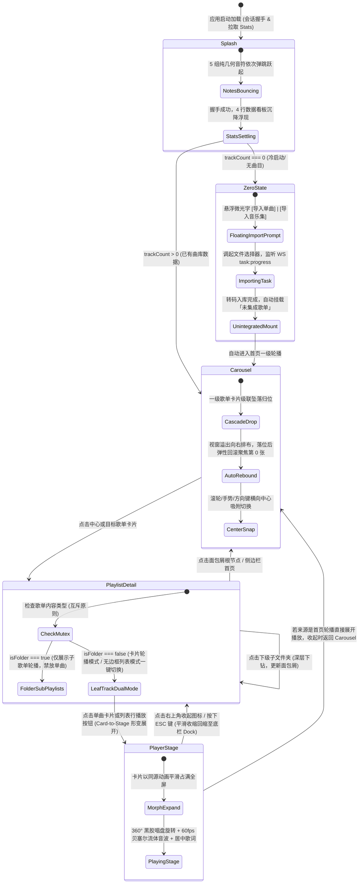

# Wavelet - 视图路由与状态机工作流规范

> **规范版本**：v1.0.0  
> **所属阶段**：Phase 1 - 架构与规格定义  
> **关联依据**：[前端设计.md](file:///home/Skualeilu/Projects/Wavelet/documents/前端设计.md) / [前端开发路线.md](file:///home/Skualeilu/Projects/Wavelet/documents/前端开发路线.md)

---

## 1. 顶层视图状态机 (App View State Machine)

Wavelet 前端摈弃传统的扁平 URL 页面刷新跳转，采用**全局单页有限状态机（Finite State Machine, FSM）**驱动视图流转。状态机受 `ui.store` 与 `library.store` 统一调控，实现丝滑流畅的无缝视觉变形（Morphing）与动效接力。



---

## 2. 状态转移矩阵与守卫条件 (State Transition Matrix)

| 当前状态 (`Current`) | 触发事件 (`Event`) | 守卫条件 (`Guard`) | 目标状态 (`Next`) | 伴随行为与动效动作 (`Action & Motion`) |
| :--- | :--- | :--- | :--- | :--- |
| **`splash`** | `STATS_LOADED` | `trackCount === 0` | **`zero`** | 音符与看板优雅淡出（`opacity: 0`），零曲目悬浮文字轻盈渐入。 |
| **`splash`** | `STATS_LOADED` | `trackCount > 0` | **`carousel`** | 启动看板淡出，触发一级歌单卡片从顶部（`y: -120px`）级联坠落入场。 |
| **`zero`** | `IMPORT_COMPLETED` | `importedCount > 0` | **`carousel`** | 进度条收起，自动挂载 `default_unintegrated_tracks` 并平滑转场至首页轮播。 |
| **`carousel`** | `SELECT_PLAYLIST` | `targetPlaylist !== null` | **`playlist-detail`** | 一级轮播卡片向两侧淡退退场，目标歌单以展开动效载入，渲染面包屑。 |
| **`playlist-detail`** | `NAVIGATE_BREADCRUMB`| `level === 0` (根) | **`carousel`** | 歌单详情视图收拢，平滑回退至首页一级歌单横向吸附轮播。 |
| **`playlist-detail`** | `OPEN_SUB_FOLDER` | `folder.isFolder === true`| **`playlist-detail`** | 更新面包屑路径，下级子歌单卡片级联坠落展示，保持互斥约束。 |
| **`playlist-detail`** | `SELECT_TRACK` | `track !== null` | **`player-stage`** | 触发 `Card-to-Stage` 形变转场，曲目卡片同源平滑展开至沉浸大舞台。 |
| **`player-stage`** | `COLLAPSE_STAGE` / `KEY_ESC` | 无 | **`playlist-detail`** 或 **`carousel`** | 全屏大舞台平滑收敛回缩至底栏 `FloatingPlayerDock`，音乐播放不中断。 |

---

## 3. 深层嵌套歌单面包屑工作流规范

针对多级嵌套分类文件夹（例如：`全部音乐 > ACG 音乐 > J-Pop 专区 > 鎖那 精选集`）：

1. **面包屑数据结构**：
   ```typescript
   interface BreadcrumbItem {
     id: string;          // 歌单或文件夹 ID ('root' 代表首页)
     name: string;        // 显示名称 (如 '全部音乐', 'ACG 音乐')
     isFolder: boolean;   // 是否为目录文件夹
   }
   ```
2. **栈管理规则**：
   - 进入首页时，面包屑栈重置为：`[{ id: 'root', name: '曲库大厅', isFolder: true }]`。
   - 点击任一文件夹时，将该文件夹追加至栈顶。
   - 点击面包屑中间某一层级时，将该层级之后的所有记录弹出（Pop），视图平滑切回目标层级。

---

## 4. 全局键盘快捷键映射矩阵 (Keyboard Navigation)

前端统一挂载 `useKeyboardShortcuts` 监听器，提供发烧级极客快捷交互：

| 快捷键 | 作用域 | 行为动作 | 关联状态机流转 |
| :--- | :--- | :--- | :--- |
| **`Space`** (空格) | 全局 (非输入框聚焦) | 切换播放 / 暂停（`togglePlayPause`） | 保持当前视图，触发播放中枢状态切换 |
| **`Escape`** (ESC) | `player-stage` | 收起播放大舞台，返回上一层视图 | `player-stage` $\rightarrow$ `playlist-detail` / `carousel` |
| **`Escape`** (ESC) | `PlayQueueDrawer` 展开时 | 关闭右侧播放队列抽屉面板 | 仅关闭抽屉，保持当前主视图 |
| **`ArrowLeft`** (←) | `carousel` | 轮播向左移动一位，聚焦吸附上一张卡片 | 轮播索引 `- 1`，阻尼吸附 |
| **`ArrowRight`** (→)| `carousel` | 轮播向右移动一位，聚焦吸附下一张卡片 | 轮播索引 `+ 1`，阻尼吸附 |
| **`ArrowLeft`** (←) | `player-stage` / `FloatingPlayerDock` | 快退 5 秒（Seek -5s） | 调整播放进度 |
| **`ArrowRight`** (→)| `player-stage` / `FloatingPlayerDock` | 快进 5 秒（Seek +5s） | 调整播放进度 |
| **`KeyM`** | 全局 | 一键静音 / 恢复音量（`toggleMute`） | 切换静音状态 |
| **`KeyQ`** | 全局 | 打开 / 收起右侧播放队列抽屉面板 | `ui.store` 切换 `isQueueDrawerOpen` |
