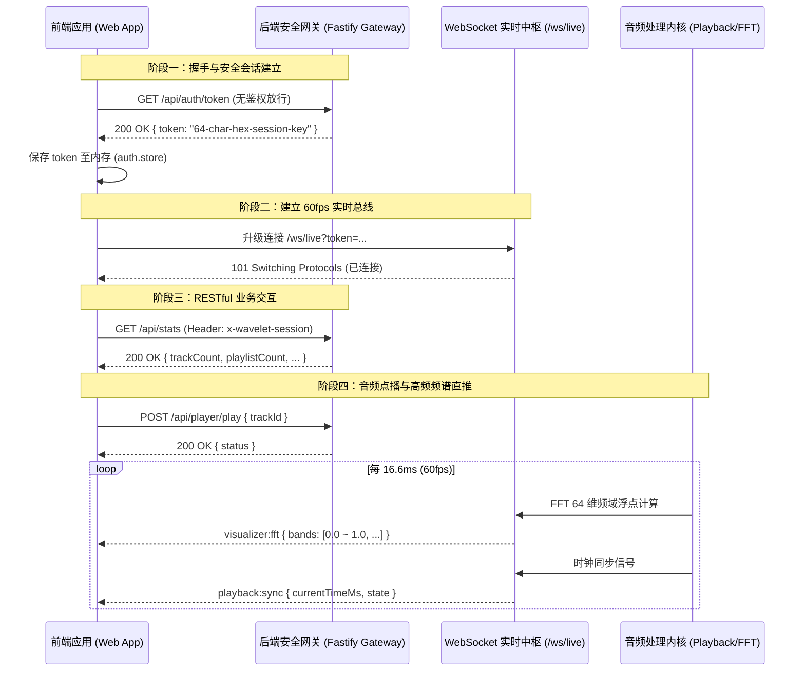

# Wavelet - API 契约映射与网络通信规范

> **规范版本**：v1.0.0  
> **所属阶段**：Phase 1 - 架构与规格定义  
> **关联依据**：[后端架构设计.md](file:///home/Skualeilu/Projects/Wavelet/documents/后端架构设计.md) / [前端开发路线.md](file:///home/Skualeilu/Projects/Wavelet/documents/前端开发路线.md)

---

## 1. 网络通信协议栈与安全会话架构

Wavelet 前端与后端通信采用 **RESTful API + WebSocket 双通道协议栈**：
1. **控制与管理信令**：基于 HTTP/1.1 RESTful 接口（JSON 载荷），负责元数据查询、歌单增删改查、导入调度与常规播放控制。
2. **高频流媒体与频域可视化**：基于 WebSocket 双向长连接（`/ws/live`），专职承载 60fps（16.6ms/帧）的 64 维 FFT 频谱直推、时钟校准与任务进度广播。
3. **音频流直通**：基于带有 HTTP Range 支持的单曲点播流（`GET /api/tracks/:id/stream`）。



---

## 2. RESTful API 契约全景字典

所有需鉴权的 RESTful 接口必须在请求头携带：  
`x-wavelet-session: <sessionToken>`  
媒体直连资源（音频流、波形、封面）可通过 URL Query 参数携带：`?token=<sessionToken>`。

### 2.1 会话与启动看板模块
| 接口方法 | 路径 | 认证要求 | 请求体 / Query | 返回状态码与载荷结构 | 说明 |
| :--- | :--- | :--- | :--- | :--- | :--- |
| `GET` | `/api/auth/token` | 否 | 无 | `200` `{ token: string }` | 应用冷启动时换取单次会话临时密钥 |
| `GET` | `/api/stats` | 是 | 无 | `200` `LibraryStats` (曲目总数、歌单数、平均时长、总播放时长) | 供 `SplashView` 首屏秒级展现曲库看板 |

### 2.2 曲目管理与点播流模块
| 接口方法 | 路径 | 认证要求 | 请求体 / Query | 返回状态码与载荷结构 | 说明 |
| :--- | :--- | :--- | :--- | :--- | :--- |
| `GET` | `/api/tracks` | 是 | `?query=&sort=recent\|played\|frequent\|hires\|title\|artist&page=1&limit=50` | `200` `{ items: Track[], total: number }` | 分页检索曲库，支持多模式动态排序 |
| `GET` | `/api/tracks/:id` | 是 | 无 | `200` `Track` | 获取单曲详细元数据 |
| `GET` | `/api/tracks/:id/stream` | 是 | Query `?token=` (支持 Range 头) | `200` / `206 Partial Content` (Audio Stream) | Web Audio HTTP Range 音频流播放 |
| `GET` | `/api/tracks/:id/waveform` | 是 | 无 | `200` `WaveformData` (`{ trackId, duration, peaks: number[128] }`) | 获取单曲 128 点归一化波形峰值 |
| `POST` | `/api/tracks/:id/favorite` | 是 | 无 | `200` `{ isFavorite: boolean }` | 一键心动收藏 / 取消收藏 |

### 2.3 歌单管理与层级互斥模块
| 接口方法 | 路径 | 认证要求 | 请求体 / Query | 返回状态码与载荷结构 | 说明 |
| :--- | :--- | :--- | :--- | :--- | :--- |
| `GET` | `/api/playlists` | 是 | 无 | `200` `Playlist[]` | 获取所有平铺歌单列表 |
| `GET` | `/api/playlists/tree` | 是 | 无 | `200` `PlaylistTreeNode[]` | 获取组装完毕的完整多级嵌套目录树 |
| `POST` | `/api/playlists` | 是 | `{ name: string, description?: string, parentId?: string, isFolder?: boolean }` | `201` `Playlist` / `400` 违反互斥原则 | 创建实体歌单或分类目录文件夹 |
| `PATCH` | `/api/playlists/:id` | 是 | `{ name?: string, description?: string, parentId?: string, isFolder?: boolean }` | `200` `Playlist` / `400` 违反互斥原则 | 重命名、更新描述或移动层级 |
| `DELETE`| `/api/playlists/:id` | 是 | 无 | `200` `{ success: true }` | 级联删除歌单及其所有关联映射 |
| `GET` | `/api/playlists/:id/tracks` | 是 | 无 | `200` `Track[]` | 获取歌单内的曲目列表（若为文件夹则返回空） |
| `POST` | `/api/playlists/:id/tracks` | 是 | `{ trackId: string }` | `200` `{ success: true }` / `400` (若为目录拦截) | 向歌单添加歌曲（**自动脱离未集成歌单**） |
| `DELETE`| `/api/playlists/:id/tracks/:trackId` | 是 | 无 | `200` `{ success: true }` | 从歌单中移除指定单曲 |
| `GET` | `/api/playlists/:id/cover` | 是 | Query `?token=` | `200` (Image/WebP 流) / `404` | 获取歌单自定义封面流 |

### 2.4 播放控制与队列调度模块
| 接口方法 | 路径 | 认证要求 | 请求体 / Query | 返回状态码与载荷结构 | 说明 |
| :--- | :--- | :--- | :--- | :--- | :--- |
| `GET` | `/api/player/status` | 是 | 无 | `200` `PlaybackStatus` | 获取当前状态（播放/暂停/音量/直通） |
| `POST` | `/api/player/play` | 是 | `{ trackId: string, offsetMs?: number }` | `200` `{ status: PlaybackStatus }` | 启动单曲点播，更新播放计数 |
| `POST` | `/api/player/pause` | 是 | 无 | `200` `{ status: PlaybackStatus }` | 暂停播放，保持当前进度 |
| `POST` | `/api/player/resume`| 是 | 无 | `200` `{ status: PlaybackStatus }` | 从当前进度继续播放 |
| `POST` | `/api/player/stop` | 是 | 无 | `200` `{ status: PlaybackStatus }` | 彻底停止播放并重置时钟 |
| `POST` | `/api/player/volume`| 是 | `{ volume: number }` (0.0 ~ 1.0) | `200` `{ status: PlaybackStatus }` | 调整音量 |
| `GET` | `/api/player/queue` | 是 | 无 | `200` `PlayQueueStatus` | 获取播放队列与当前模式 |
| `POST` | `/api/player/queue` | 是 | `{ tracks: Track[], startIndex?: number }` | `200` `PlayQueueStatus` | 覆盖重置整个播放队列 |
| `POST` | `/api/player/queue/add` | 是 | `{ tracks: Track[] }` | `200` `PlayQueueStatus` | 向队列末尾追加歌曲 |
| `DELETE`| `/api/player/queue`| 是 | 无 | `200` `PlayQueueStatus` | 清空当前播放队列 |
| `POST` | `/api/player/next` | 是 | 无 | `200` `PlaybackStatus` | 依据当前播放模式无缝切到下一曲 |
| `POST` | `/api/player/previous` | 是 | 无 | `200` `PlaybackStatus` | 依据当前播放模式切到上一曲 |
| `POST` | `/api/player/play-mode` | 是 | `{ mode: 'sequence'\|'repeat-list'\|'repeat-track'\|'shuffle' }` | `200` `PlayQueueStatus` | 切换 4 种播放模式 |
| `GET` | `/api/player/devices` | 是 | 无 | `200` `{ devices: AudioDevice[] }` | 获取声卡物理设备列表 |
| `POST` | `/api/player/bit-perfect` | 是 | `{ deviceName: string, enabled: boolean }` | `200` `{ status: PlaybackStatus }` | 开关 Bit-Perfect 硬件直通 |

### 2.5 导入自愈模块
| 接口方法 | 路径 | 认证要求 | 请求体 / Query | 返回状态码与载荷结构 | 说明 |
| :--- | :--- | :--- | :--- | :--- | :--- |
| `POST` | `/api/import/batch` | 是 | `multipart/form-data` 或 `{ filePaths: string[] }` | `200` `{ taskId: string, importedTracks: Track[] }` | 多单曲批量导入，自愈后归入未集成歌单 |
| `POST` | `/api/import/directory`| 是 | `{ directoryPath: string }` | `200` `{ taskId: string, totalFilesFound: number }` | 递归扫描目录导入，实时推送进度 |

---

## 3. WebSocket 实时协议与载荷规范 (`/ws/live`)

### 3.1 连接生命周期与重连策略
- **握手地址**：`ws://<host>:<port>/ws/live?token=<sessionToken>`
- **心跳机制**：客户端每隔 `30 秒` 发送 ping：`{ type: "ping" }`，服务端响应 `{ type: "pong" }`。
- **重连退避算法**：连接非正常断开时，启动指数退避重连：
  $$\text{Delay} = \min(1000 \times 2^{\text{retryCount}}, 10000)\text{ ms}$$
  重连成功后自动重新订阅状态。

### 3.2 广播事件载荷定义

#### 1. `visualizer:fft` (高频 60fps 频谱直推)
```typescript
interface WsFftPayload {
  type: 'visualizer:fft';
  // 64 维对数加权归一化频域浮点能量 (0.000 ~ 1.000)
  bands: number[];
}
```

#### 2. `playback:sync` (高精时钟与状态同步)
```typescript
interface WsPlaybackSyncPayload {
  type: 'playback:sync';
  trackId: string | null;
  state: 'playing' | 'paused' | 'stopped';
  currentTimeMs: number;
  durationMs: number;
  volume: number;
}
```

#### 3. `player:queue` (播放队列变动广播)
```typescript
interface WsQueuePayload {
  type: 'player:queue';
  currentIndex: number;
  playMode: 'sequence' | 'repeat-list' | 'repeat-track' | 'shuffle';
  tracks: Track[];
}
```

#### 4. `task:progress` (异步导入与自愈进度)
```typescript
interface WsTaskProgressPayload {
  type: 'task:progress';
  taskId: string;
  stage: 'sniffing' | 'healing' | 'transcoding' | 'archiving' | 'completed';
  percent: number;      // 0 ~ 100
  currentFile: string;
}
```
