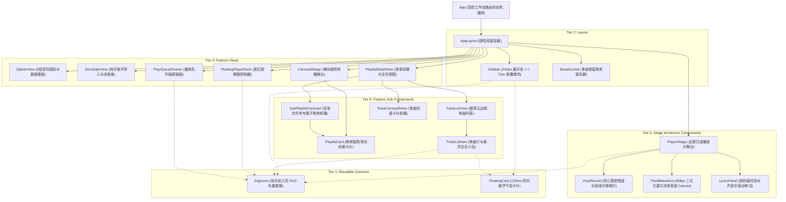

# Wavelet - 组件层级树与组件字典规范书

> **规范版本**：v1.0.0  
> **所属阶段**：Phase 1 - 架构与规格定义  
> **关联依据**：[前端设计.md](file:///home/Skualeilu/Projects/Wavelet/documents/前端设计.md) / [前端开发路线.md](file:///home/Skualeilu/Projects/Wavelet/documents/前端开发路线.md)

---

## 1. 全局组件层级树 (Component Hierarchy)



---

## 2. 组件全景字典 (Component Dictionary)

### 2.1 通用原子组件 (Common Atomic Components)

#### 1. `SvgIcons` (`src/components/common/SvgIcons.tsx`)
- **功能定位**：全量手绘纯几何定制矢量图标集合（零第三方库，零系统 Emoji）。
- **Props 契约**：
  ```typescript
  interface SvgIconProps {
    name: 
      | 'play' | 'pause' | 'previous' | 'next' 
      | 'volume' | 'volume-mute' 
      | 'repeat' | 'repeat-track' | 'shuffle' | 'sequence'
      | 'folder' | 'music' | 'heart' | 'heart-filled'
      | 'wave' | 'plus' | 'close' | 'chevron-right' | 'chevron-left'
      | 'bit-perfect' | 'list' | 'grid' | 'search' | 'clock';
    className?: string;
    size?: number; // 默认 20
    color?: string; // 默认 currentColor
  }
  ```

#### 2. `FloatingCard` (`src/components/common/FloatingCard.tsx`)
- **功能定位**：120ms 防抖悬浮气泡卡片，实现“低文字密度”极简原则。
- **Props 契约**：
  ```typescript
  interface FloatingCardProps {
    trigger: React.ReactNode;
    content: React.ReactNode;
    placement?: 'top' | 'bottom' | 'left' | 'right';
    delay?: number; // 默认 120ms
  }
  ```

---

### 2.2 布局与外壳组件 (Layout Components)

#### 1. `AppLayout` (`src/components/layout/AppLayout.tsx`)
- **功能定位**：全局响应式视窗容器，固定视窗宽高并锁定滚动条，弹性整合侧边栏、主舞台与悬浮底栏。

#### 2. `Sidebar` (`src/components/layout/Sidebar.tsx`)
- **功能定位**：弹性伸缩侧边栏。
- **内部状态**：
  - 展开态（`240px`）：呈现 Logo、默认根歌单（全部音乐、心动收藏、未集成）、多级目录树、新建按钮。
  - 折叠态（`72px`）：仅居中展现定制 SVG 图标，鼠标悬停时右侧弹出 `FloatingCard`。
- **交互事件**：`onToggleCollapse()`, `onSelectPlaylist(id)`。

#### 3. `Breadcrumb` (`src/components/layout/Breadcrumb.tsx`)
- **功能定位**：渲染深层嵌套歌单的面包屑路径。
- **Props 契约**：
  ```typescript
  interface BreadcrumbProps {
    items: Array<{ id: string; name: string; isFolder: boolean }>;
    onNavigate: (id: string, index: number) => void;
  }
  ```

---

### 2.3 启动与导入组件 (Splash & Import)

#### 1. `SplashView` (`src/components/splash/SplashView.tsx`)
- **功能定位**：呈现 5 组纯几何圆润连杆音符弹跳动画，数据加载后以 4 行阶梯轻盈浮现数据看板。
- **状态流转**：判断曲库曲目数，`0` 则淡入 `ZeroStateView`，`>0` 则转场入 `CarouselStage`。

#### 2. `ZeroStateView` (`src/components/splash/ZeroStateView.tsx`)
- **功能定位**：冷启动零曲目悬浮导入浮岛。
- **核心交互**：点击调起系统文件/目录选择器，展示转码自愈进度条，完成后自动转场入首页。

---

### 2.4 轮播舞台与卡片组件 (Carousel & Cards)

#### 1. `CarouselStage` (`src/components/carousel/CarouselStage.tsx`)
- **功能定位**：一级歌单横向中心吸附轮播大舞台。
- **动效集成**：
  - 首次进入挂载 `DropCascadeEngine`：卡片从视窗外顶部（`y: -120px`）逐个级联坠落归位。
  - 溢出时自动向右排布，最后一张就位后弹性回滚聚焦第一张。
  - 滚轮横向位移与手势拖拽惯性吸附。

#### 2. `PlaylistCard` (`src/components/carousel/PlaylistCard.tsx`)
- **Props 契约**：
  ```typescript
  interface PlaylistCardProps {
    playlist: Playlist;
    isActive: boolean; // 是否处于吸附中心
    onClick: () => void;
  }
  ```

---

### 2.5 歌单双模与互斥组件 (Playlist Detail & Mutex)

#### 1. `PlaylistDetailView` (`src/components/playlist/PlaylistDetailView.tsx`)
- **功能定位**：歌单详情页调度中枢，**严格执行“歌单/歌曲互斥原则”**：
  - 若 `isFolder === true` 或已含子歌单：渲染 `SubPlaylistCarousel`，**彻底屏蔽单曲添加入口**。
  - 若为纯实体歌单：渲染单曲列表/卡片双模，**彻底屏蔽添加子歌单/文件夹入口**。

#### 2. `TrackListItem` (`src/components/playlist/TrackListItem.tsx`)
- **功能定位**：无边框轻量曲目行。
- **交互特征**：
  - 常态显示：序号、曲名、艺术家、时长、Hi-Res 采样规格标、健康微绿标。
  - Hover 态：平滑浮出悬浮小岛（一键播放、心动红心收藏、加入播放队列、从歌单移除）。

---

### 2.6 播放控制器与大舞台组件 (Player & Stage)

#### 1. `FloatingPlayerDock` (`src/components/player/FloatingPlayerDock.tsx`)
- **功能定位**：居中悬浮底栏超椭圆控制器（底边 `20px` 悬浮，最大宽度 `880px`）。
- **组件集成**：微缩呼吸封面、上一曲/播放暂停/下一曲、流体细微进度条 Seek、Bit-Perfect 胶囊灯、播放模式循环切换、音量微滑块、队列抽屉开关。

#### 2. `PlayQueueDrawer` (`src/components/player/PlayQueueDrawer.tsx`)
- **功能定位**：从右侧/底部弹性滑出的轻量半透明播放队列抽屉，支持插播、移出与一键清空。

#### 3. `PlayerStage` (`src/components/player/PlayerStage.tsx`)
- **功能定位**：全屏沉浸播放大舞台，由单曲卡片通过 `Card-to-Stage` 形变同源展开。
- **子组件协同**：
  - `VinylRecord`：360° 同心纹理黑胶旋转与物理唱针升降。
  - `FluidWaveform`：纯 Canvas 2D 绘制的 60fps Catmull-Rom 三次贝塞尔流体音波。
  - `LyricsPanel`：高精时钟对齐的居中滚动歌词，点击即 Seek。
  - `ESC` 键或点击收起图标平滑收敛回归底栏 Dock。
