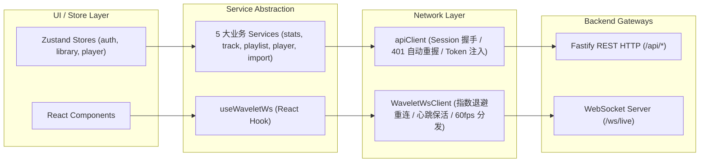

# Wavelet - API 模块与 WebSocket 通信手册

> **规范版本**：v1.0.0  
> **所属阶段**：Phase 3 - 网络通信层与 API 模块统一封装  
> **关联依据**：[03_API契约与网络通信规范.md](file:///home/Skualeilu/Projects/Wavelet/documents/前端开发/01_架构与设计规范/03_API契约与网络通信规范.md) / [前端开发路线.md](file:///home/Skualeilu/Projects/Wavelet/documents/前端开发路线.md)

---

## 1. 网络层核心架构设计

Wavelet 前端数据通信层严格隔离于 UI 视图之外，通过 **单例 Fetch 客户端（`apiClient.ts`）** 与 **WebSocket 60fps 实时总线（`websocket.ts`）** 提供强类型、高容错、自愈式的双向通信基石。



---

## 2. API Client 核心机制 (`src/services/apiClient.ts`)

### 2.1 会话安全握手与 401 自动重连 (Self-Healing Session)
1. **内存 Token 单例维护**：会话密钥保存在内存中，防止恶意跨站脚本盗取本地持久化存储。
2. **静默握手机制**：首次发起任何 API 调用前，若检测到尚未取得 Token，`apiClient` 会自动发起 `GET /api/auth/token` 静默换取密钥。
3. **401 自动重握手容灾**：若后端服务重启导致现有 Token 失效（返回 HTTP 401），`apiClient` 会自动清空当前 Token、重新静默换取新 Token 并**自动重试当前失败的请求一次**，整个过程对上层业务无感。

### 2.2 媒体直连 URL 构造器
由于音频播放标签（`<audio>`）与波形/封面图片通常直接由浏览器原生网络引擎请求，`apiClient` 提供了安全的签名 URL 生成函数：
- `getAudioStreamUrl(trackId: string): string` $\rightarrow$ `/api/tracks/:id/stream?token=<token>`
- `getCoverUrl(playlistId: string): string` $\rightarrow$ `/api/playlists/:id/cover?token=<token>`

---

## 3. 5 大业务服务模块调用字典

### 3.1 启动看板统计服务 (`src/services/stats.service.ts`)
```typescript
import { statsService } from '@/services/stats.service';

// 获取启动看板秒级聚合数据
const stats = await statsService.getStats();
// 返回: { trackCount, playlistCount, avgDurationFormatted, totalDurationFormatted }
```

### 3.2 曲目管理与波形服务 (`src/services/track.service.ts`)
```typescript
import { trackService } from '@/services/track.service';

// 1. 分页检索曲库并动态排序 ('recent' | 'played' | 'frequent' | 'hires' | 'title' | 'artist')
const { items, total } = await trackService.getTracks({ query: '鎖那', sort: 'frequent', limit: 20 });

// 2. 获取整轨 128 点归一化波形峰值
const waveform = await trackService.getWaveform('trk_001');

// 3. 一键切换心动红心收藏
const { isFavorite } = await trackService.toggleFavorite('trk_001');
```

### 3.3 歌单管理与互斥服务 (`src/services/playlist.service.ts`)
```typescript
import { playlistService } from '@/services/playlist.service';

// 1. 获取完整多级嵌套目录树
const tree = await playlistService.getPlaylistTree();

// 2. 创建分类目录文件夹 (isFolder: true，只放子歌单，禁放单曲)
const folder = await playlistService.createPlaylist({ name: 'ACG 专区', isFolder: true });

// 3. 向歌单添加歌曲 (若目标为目录自动拦截报错，添加成功后曲目自动脱离未集成歌单)
await playlistService.addTrackToPlaylist(playlist.id, track.id);
```

### 3.4 播放控制与队列中枢服务 (`src/services/player.service.ts`)
```typescript
import { playerService } from '@/services/player.service';

// 1. 点播指定曲目
await playerService.play('trk_001');

// 2. 覆盖重置播放队列
await playerService.setQueue(tracks, 0);

// 3. 依据当前模式切下一曲
await playerService.next();

// 4. 切换播放模式 ('sequence' | 'repeat-list' | 'repeat-track' | 'shuffle')
await playerService.setPlayMode('shuffle');
```

### 3.5 导入自愈服务 (`src/services/import.service.ts`)
```typescript
import { importService } from '@/services/import.service';

// 1. 多音频文件批量导入 (自愈后自动归入未集成歌单)
const result = await importService.importBatch(['/path/to/song1.flac', '/path/to/song2.mp3']);

// 2. 目录递归扫描导入
const task = await importService.importDirectory('/home/music/HiRes');
```

---

## 4. WebSocket 60fps 实时通信总线与 React Hook

### 4.1 长连接架构 (`src/services/websocket.ts`)
- **断线指数退避重连**：当网络波动或服务端短暂重启时，自动以 $1\text{s} \rightarrow 2\text{s} \rightarrow 4\text{s} \rightarrow 8\text{s} \rightarrow 10\text{s}$ 步进重连。
- **30s 心跳保活**：定时发送 `{ type: "ping" }` 并响应 `{ type: "pong" }`。
- **高频数据旁路**：`visualizer:fft` 每 16.6ms 广播一次 64 维频域浮点能量数组，由总线直接通知 Canvas 渲染管线，杜绝任何中间状态转换开销。

### 4.2 React Hook (`src/hooks/useWaveletWs.ts`)
组件内部通过调用 `useWaveletWs` 挂载事件监听，组件卸载时 Hook 自动注销监听句柄，保证零内存泄漏：

```typescript
useWaveletWs({
  onFft: (bands) => {
    // 64 维频域浮点直推 Canvas 2D
    canvasRenderer.render(bands);
  },
  onPlaybackSync: (sync) => {
    // 毫秒级时钟对齐
    syncTime(sync.currentTimeMs);
  },
  onQueue: (queue) => {
    // 队列变动通知
  },
  onTaskProgress: (progress) => {
    // 导入自愈百分比
  },
});
```
