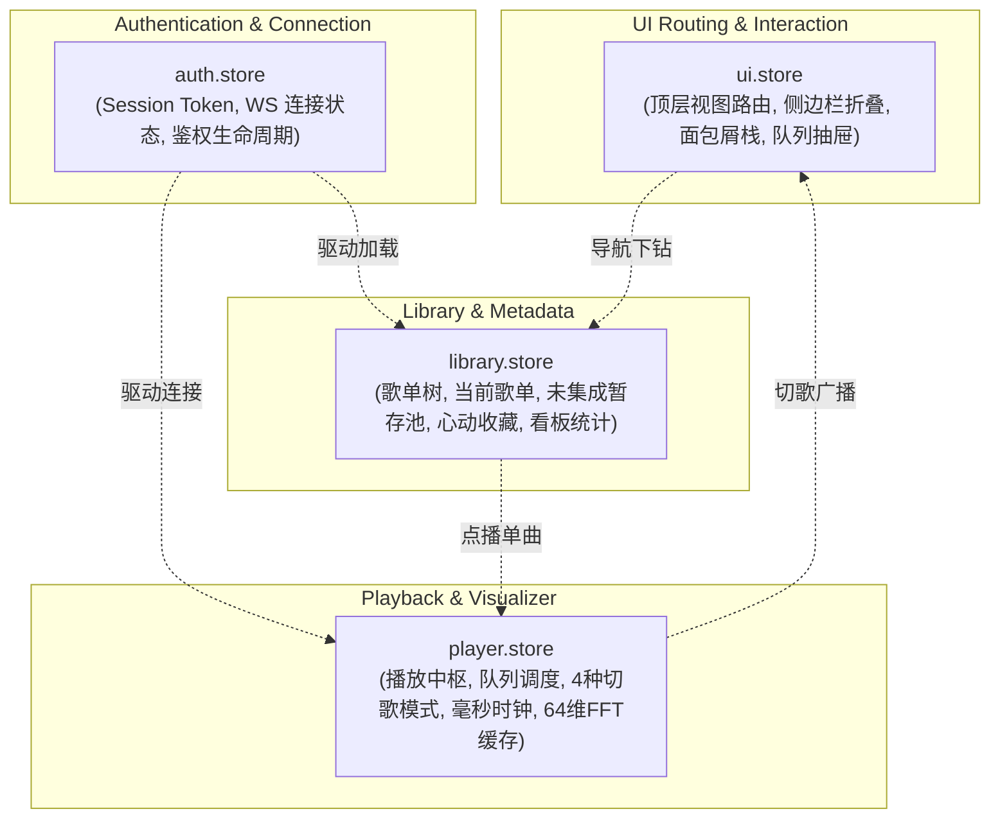

# Wavelet - Zustand 全局状态流转拓扑规范

> **规范版本**：v1.0.0  
> **所属阶段**：Phase 4 - 全局响应式状态中枢  
> **关联依据**：[02_路由与状态机工作流规范.md](file:///home/Skualeilu/Projects/Wavelet/documents/前端开发/01_架构与设计规范/02_路由与状态机工作流规范.md) / [前端开发路线.md](file:///home/Skualeilu/Projects/Wavelet/documents/前端开发路线.md)

---

## 1. 状态中枢全景拓扑 (Store Topology)

Wavelet 前端状态层基于 **Zustand v5** 构建，按照单一职责与关注点分离（Separation of Concerns）划分为四大正交状态切片：

---

## 2. 四大核心 Store 职责与状态规格

### 2.1 认证与连接状态中枢 (`src/stores/auth.store.ts`)
- **核心状态**：
  - `token: string | null`：内存单例密钥。
  - `isConnected: boolean`：WebSocket 实时总线在线状态。
  - `isAuthenticating: boolean`：正在握手状态。
- **动作 (Actions)**：
  - `authenticate()`：向网关发起 `GET /api/auth/token` 完成一次性握手。
  - `setConnected(connected: boolean)`：响应网络或 WS 连接状态变更。
  - `logout()`：清除会话并重置连接。

### 2.2 曲库与歌单资产状态中枢 (`src/stores/library.store.ts`)
- **核心状态**：
  - `playlists: Playlist[]`：平铺歌单列表。
  - `playlistTree: PlaylistTreeNode[]`：多级嵌套树形目录结构。
  - `currentPlaylist: Playlist | null`：当前选中的歌单。
  - `currentPlaylistTracks: Track[]`：当前歌单内的单曲列表。
  - `unintegratedPlaylist: Playlist | null`：派生提取的「未集成歌单」（新导入曲目暂存池）。
  - `favoritesPlaylist: Playlist | null`：派生提取的「心动收藏」歌单。
  - `stats: LibraryStats | null`：启动看板聚合统计数据。
- **动作 (Actions)**：
  - `fetchPlaylists()` / `fetchPlaylistTree()`：拉取歌单元数据并提取未集成/心动歌单。
  - `selectPlaylist(playlist)`：切换激活歌单并自动拉取内部曲目。
  - `refreshStats()`：秒级刷新启动看板统计。
  - `createPlaylist(input)` / `deletePlaylist(id)`：增删歌单并自动更新目录树。
  - `addTrackToPlaylist(playlistId, trackId)`：添加曲目，自动从未集成歌单中移出并更新计数。
  - `toggleTrackFavorite(trackId)`：心动收藏一键切换。

### 2.3 播放控制与实时频谱状态中枢 (`src/stores/player.store.ts`)
- **核心状态**：
  - `status: PlaybackStatus`：底层播放综合状态（播放/暂停/停止/音量/模式）。
  - `currentTrack: Track | null`：当前播放曲目详情。
  - `currentTimeMs: number` / `durationMs: number`：毫秒级播放进度。
  - `queue: Track[]` / `currentIndex: number`：播放队列与指针。
  - `playMode: PlayMode`：`sequence` | `repeat-list` | `repeat-track` | `shuffle`。
  - `fftBands: number[]`：64 维对数加权归一化能量浮点数组（供 Canvas 2D 贝塞尔曲线实时渲染）。
  - `bitPerfectEnabled: boolean`：发烧级硬件直通指示。
  - `isMuted: boolean` / `lastVolume: number`：静音状态保持。
- **动作 (Actions)**：
  - `playTrack(track, queueContext?)`：点播单曲，若传入歌单上下文则自动载入整个队列。
  - `togglePlayPause()` / `pause()` / `resume()` / `stop()`：播放机控制。
  - `seek(timeMs)`：进度精确定位。
  - `next()` / `previous()`：依据当前 4 种播放模式切歌。
  - `setPlayMode(mode)`：循环切换播放模式。
  - `setQueue(tracks, startIndex?)` / `addToQueue(tracks)` / `removeFromQueue(index)` / `clearQueue()`：队列管理。
  - `setFftBands(bands)`：高频直接覆写 64 维频谱数据。
  - `syncPlayback(sync)`：毫秒级时钟对齐。

### 2.4 视图路由与交互状态中枢 (`src/stores/ui.store.ts`)
- **核心状态**：
  - `currentView: AppView`：当前活动视图（`splash` | `zero` | `carousel` | `playlist-detail` | `player-stage`）。
  - `previousView: AppView | null`：上一级视图（供 ESC 或收起时精准回退）。
  - `isSidebarCollapsed: boolean`：弹性侧边栏折叠态（`240px` $\leftrightarrow$ `72px`）。
  - `isQueueDrawerOpen: boolean`：右侧/底部播放队列抽屉展开态。
  - `playlistViewMode: PlaylistViewMode`：实体歌单卡片轮播模式（`cards`）与无边框列表模式（`list`）切换。
  - `breadcrumbStack: BreadcrumbItem[]`：多层级嵌套歌单面包屑下钻导航栈。
- **动作 (Actions)**：
  - `navigate(view)` / `goBack()`：工作流状态机路由跳转。
  - `toggleSidebar()` / `setSidebarCollapsed(collapsed)`：侧边栏状态控制。
  - `toggleQueueDrawer()` / `setQueueDrawerOpen(open)`：队列抽屉控制。
  - `setPlaylistViewMode(mode)`：歌单双模形态切换。
  - `pushBreadcrumb(item)` / `popBreadcrumb(toIndex?)` / `resetBreadcrumbs()`：面包屑栈操作。

---

## 3. 性能优化与数据流隔离原则

1. **高频 FFT 数据旁路隔离**：
   - `player.store.ts` 中的 `fftBands` 虽然保存在 Store 中，但在沉浸大舞台组件（`FluidWaveform.tsx`）中，**直接通过 `useWaveletWs` 的回调喂入 Canvas 的 `requestAnimationFrame` 内部闭包**，绝不通过 React `usePlayerStore((s) => s.fftBands)` 触发每秒 60 次的组件重渲染。
2. **细粒度选择器订阅 (Granular Selectors)**：
   - 组件消费 Store 时必须使用细粒度选择器（如 `const isPlaying = usePlayerStore((s) => s.status.state === 'playing')`），避免整 Store 订阅引起的无关重渲染。
