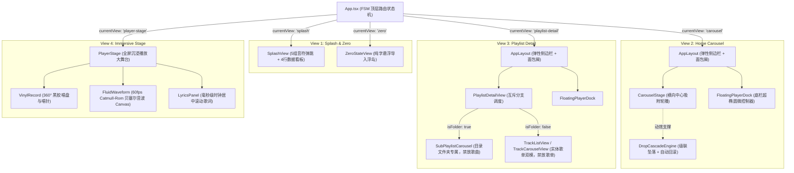

# Wavelet - 页面视图与核心业务交互实现报告

> **规范版本**：v1.0.0  
> **所属阶段**：Phase 6 - 页面视图与核心业务模块实现  
> **关联依据**：[02_路由与状态机工作流规范.md](file:///home/Skualeilu/Projects/Wavelet/documents/前端开发/01_架构与设计规范/02_路由与状态机工作流规范.md) / [前端设计.md](file:///home/Skualeilu/Projects/Wavelet/documents/前端设计.md)

---

## 1. 业务视图架构与组件集成拓扑

Wavelet 前端顶层架构由全局单页有限状态机（`AppView`）驱动，所有核心业务模块（外壳、启动、导入、轮播、互斥双模歌单、底栏控制器、沉浸播放舞台）已完成全量编码落地与单向数据绑定。

---

## 2. 6 大核心模块实现细节与交互特征

### 2.1 全局弹性视窗外壳与导航 (`AppLayout.tsx`, `Sidebar.tsx`, `Breadcrumb.tsx`)
1. **弹性伸缩侧边栏**：
   - 展开态（`240px`）：呈现 Logo 品牌、系统核心歌单（全部音乐、心动收藏、未集成音乐）、分类目录树及底部 Bit-Perfect 指示器。
   - 折叠态（`72px`）：平滑收缩，仅居中保留纯几何图标，配合 `FloatingCard` 悬停浮现说明。
   - 切换时由 `springMotion.sidebar`（`stiffness: 320, damping: 26`）赋予高品质阻尼回弹。
2. **多层级嵌套歌单面包屑**：
   - 自动响应目录层级下钻（如 `全部音乐 > ACG 音乐 > J-Pop 专区`），点击任意层级可即时回跳。

### 2.2 启动与零曲目导入视图 (`SplashView.tsx`, `ZeroStateView.tsx`)
1. **5 组艺术音符弹跳**：
   - 依次延迟 `100ms` 从基线下方 `y: 28px` 弹性跃起归位。
   - 数据预热与握手完成后，以阶梯形式轻盈呈现 4 行曲库统计指标（曲目数、歌单数、单曲平均时长、累计总时长）。
2. **零曲目悬浮导入浮岛**：
   - 当曲目数为 0 时无缝转入，展现纯字极简按钮 `[ 导入单曲文件 ]` 与 `[ 导入整辑目录 ]`。
   - 对接原生文件选择器与 WebSocket `task:progress`，实时呈现自愈转码进度条，入库完成后自动归入「未集成歌单」并流转至首页。

### 2.3 首页一级歌单横向中心吸附轮播 (`CarouselStage.tsx`, `PlaylistCard.tsx`, `DropCascadeEngine.ts`)
1. **级联自顶坠落与自动回滚**：
   - 卡片依次从顶部视窗外（`y: -120px`）级联坠落归位；超出视窗向右位移排布。
   - 最后一张卡片入场后，整个轮播轨道由 `springMotion.rebound` 自动平滑向左回滚，精准聚焦至第 0 张卡片。
2. **中心磁吸（Center-Snap）**：
   - 处于中心选中的卡片放大至 `scale: 1.05`，投影加深为 `--shadow-hover`；两侧卡片轻度退缩。
   - 支持鼠标滚轮左右位移转换为水平惯性滑动、触控板手势以及卡片点击对齐。

### 2.4 歌单内部双模展示与层级互斥 (`PlaylistDetailView.tsx`, `SubPlaylistCarousel.tsx`, `TrackListView.tsx`, `TrackCarouselView.tsx`)
1. **严格互斥分支渲染**：
   - **若为分类目录文件夹 (`isFolder === true`)**：渲染 `SubPlaylistCarousel`，**彻底屏蔽单曲添加入口、单曲行与曲目播放列表**。
   - **若为纯实体歌单 (`isFolder === false`)**：展示单曲内容，**彻底屏蔽新建子文件夹或添加子歌单入口**。
2. **实体歌单双模切换**：
   - **极简无边框列表模式 (`TrackListView`)**：序号、曲名、艺术家、采样规格微标（如 `96k/24b`）、Hover 浮出交互小岛（一键播放、心动收藏、加入队列、移出）。
   - **封面卡片轮播模式 (`TrackCarouselView`)**：沉浸浏览单曲大卡片，点击任意卡片触发 `Card-to-Stage` 形变转场。

### 2.5 悬浮底栏超椭圆控制器与队列抽屉 (`FloatingPlayerDock.tsx`, `PlayQueueDrawer.tsx`)
1. **超椭圆控制器**：
   - 居中悬浮脱离底边 `20px`，最大宽度 `880px`，磨砂半透明纯白底板。
   - 集成微缩旋转黑胶、单曲信息（点击形变展开至大舞台）、播放/暂停、上一曲/下一曲、流体 Seeking 时间槽、Bit-Perfect 胶囊灯、4 种切歌模式循环切换与音量微滑块。
2. **播放队列抽屉面板**：
   - 从界面右侧弹性滑出，展示队列曲目，当前曲目带有音波动态小图标，支持点击切歌、移出单曲与一键清空。

### 2.6 沉浸播放大舞台与 60fps 贝塞尔流体音波 (`PlayerStage.tsx`, `VinylRecord.tsx`, `FluidWaveform.tsx`, `LyricsPanel.tsx`)
1. **同心纹理黑胶唱盘与物理唱针**：
   - 播放时驱动 360° 平稳旋转（3 秒/圈），暂停时微回弹减速，唱针以圆弧抬升复位。
2. **Canvas 2D 60fps Catmull-Rom 三次贝塞尔流体音波**：
   - 纯 Canvas 渲染管线，在 `requestAnimationFrame` 闭包内直接消费 64 维频域浮点数组，拟合温润水流波动，零 React DOM 重绘开销。
3. **居中滚动动态歌词**：
   - 毫秒级时钟对齐，当前演唱行垂直居中高亮并放大 1.05 倍，点击任一行即时跳转 Seek。
4. **快捷收起**：
   - 支持点击左上角或右上角收起图标，或**按下键盘 `ESC` 键**，全屏无缝收拢回缩至悬浮底栏，播放持续不中断。
