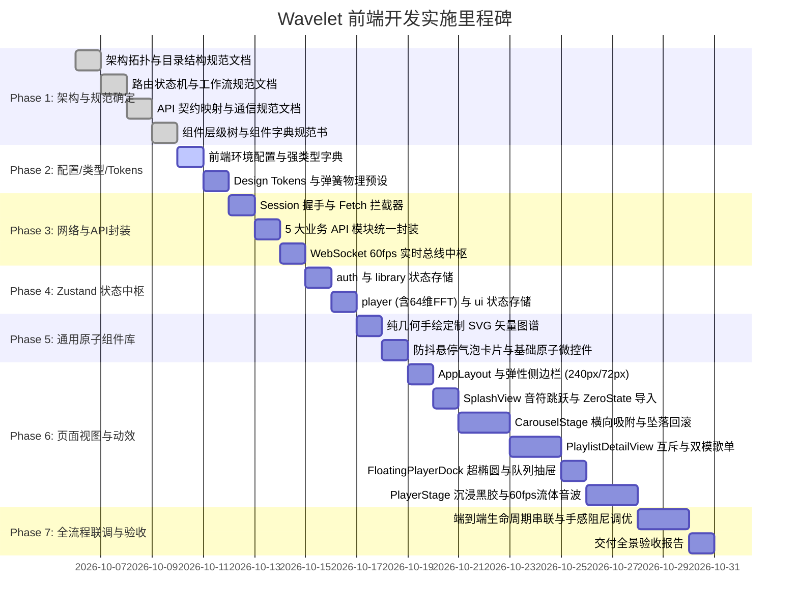

# Wavelet - 前端开发实施路线图与文档产出规范 (Roadmap & Deliverables)

> **设计宗旨**：本路线图紧密围绕《[前端设计.md](file:///home/Skualeilu/Projects/Wavelet/documents/前端设计.md)》规范，采用严格工程化顺序：**先确定组件、API、路由、配置、架构与目录结构，再落地配置、类型、Tokens 与 API 模块，接着构建通用复用组件，最后组装业务页面与动效**。
> **范围说明**：本路线图专注于前端工程架构、UI/UX 交互与业务中枢代码实现，**不包含任何前端测试模块**。
> **文档产出准则**：每个开发阶段均设有明确的**技术文档产出物**，归档于 `documents/前端开发/` 体系中，确保架构可溯源、接口契约明确、组件复用可查。

---

## 1. 前端研发实施甘特图



---

## 2. 全阶段文档产出确认矩阵 (Documentation Deliverables)

为确保“开发有依据，产出有文档”，本次前端开发划分出 **12 份专项技术文档**，统一归档于 `documents/前端开发/` 目录结构中：

```
documents/前端开发/
├── 01_架构与设计规范/
│   ├── 01_架构设计与工程拓扑规范.md          <-- [Phase 1 产出]
│   ├── 02_路由与状态机工作流规范.md          <-- [Phase 1 产出]
│   ├── 03_API契约与网络通信规范.md          <-- [Phase 1 产出]
│   └── 04_组件层级树与组件字典.md            <-- [Phase 1 产出]
├── 02_基石与通信实现/
│   ├── 01_前端配置与类型体系设计.md          <-- [Phase 2 产出]
│   ├── 02_设计系统Tokens与动效字典.md        <-- [Phase 2 产出]
│   └── 03_API模块与WebSocket通信手册.md     <-- [Phase 3 产出]
├── 03_状态机与组件库/
│   ├── 01_Zustand全局状态流转拓扑.md        <-- [Phase 4 产出]
│   └── 02_定制纯几何SVG与原子组件库.md       <-- [Phase 5 产出]
├── 04_页面视图与交互/
│   └── 01_页面视图与核心业务交互实现报告.md  <-- [Phase 6 产出]
└── 05_交付验收/
    └── 前端全流程交付与体验验收报告.md        <-- [Phase 7 产出]
```

### 详细文档产出清单与规格说明

| 阶段 | 交付文档相对路径 | 文档标题 | 核心记载内容与质量规格 | 交付标准 |
| :--- | :--- | :--- | :--- | :--- |
| **Phase 1** | `01_架构与设计规范/01_架构设计与工程拓扑规范.md` | **前端架构设计与工程拓扑规范** | 前端单向依赖分层架构（Config $\rightarrow$ Services $\rightarrow$ Stores $\rightarrow$ Components $\rightarrow$ Views）、`src` 目录树组织原则、Monorepo 包引用规范与代码整洁守则。 | 架构图清晰，模块边界无循环依赖 |
| **Phase 1** | `01_架构与设计规范/02_路由与状态机工作流规范.md` | **视图路由与状态机工作流规范** | 5 大核心视图（`splash`, `zero`, `carousel`, `playlist-detail`, `player-stage`）状态转移矩阵、流转触发条件、沉浸返回机制、键盘 ESC 路由映射。 | 状态转换图闭环，无死锁状态 |
| **Phase 1** | `01_架构与设计规范/03_API契约与网络通信规范.md` | **API 契约映射与网络通信规范** | 26+ 个 RESTful 接口路径/入参/返回值字典、会话令牌 Session 握手流程、WebSocket 4 类高频广播协议格式与 60fps 频域浮点解包契约。 | 与后端路由代码 100% 对齐 |
| **Phase 1** | `01_架构与设计规范/04_组件层级树与组件字典.md` | **组件层级树与组件字典规范书** | 前端所有组件全景清单（基础原子组件、布局外壳组件、业务功能组件、舞台组件）、每个组件的 Props/Events 契约、复用边界。 | 覆盖全景 UI，无遗漏组件 |
| **Phase 2** | `02_基石与通信实现/01_前端配置与类型体系设计.md` | **前端配置与强类型体系设计** | 环境变量定义、运行时配置参数（网络、音频、动画）、复用强类型定义（复用 `@wavelet/shared` + 前端专属 UI 类型）、零 `any` 规则说明。 | 类型定义严密，编译零报错 |
| **Phase 2** | `02_基石与通信实现/02_设计系统Tokens与动效字典.md` | **设计系统 Tokens 与动效字典** | 纯白 INS 调色板定义、4 档柔和微投影、圆润字体排印、Framer Motion 物理弹簧阻尼参数对照表（Stiffness, Damping, Mass）。 | 视觉参数完整，代码变量可追溯 |
| **Phase 3** | `02_基石与通信实现/03_API模块与WebSocket通信手册.md` | **API 模块与 WebSocket 通信手册** | Fetch 客户端封装细节、Session 拦截与 Token 注入机制、5 大业务 API 模块调用范式、WebSocket 断线重连与高频分发实现机制。 | 网络调用封装彻底，无散落 Fetch |
| **Phase 4** | `03_状态机与组件库/01_Zustand全局状态流转拓扑.md` | **Zustand 全局状态流转拓扑** | `auth`、`library`、`player`、`ui` 四大 Store 的 State 结构、Action 清单、派生状态选择器（Selectors）以及 64 维 FFT 实时数据缓冲机制。 | 状态机拓扑清晰，流转可预测 |
| **Phase 5** | `03_状态机与组件库/02_定制纯几何SVG与原子组件库.md` | **纯几何定制 SVG 与原子组件库** | 全量手绘纯几何 SVG 图标图谱（零三方图标库/零Emoji）、`FloatingCard` 防抖悬停气泡卡片、胶囊徽标、流体滑块等基础组件使用文档与代码片段。 | 组件独立可插拔，手绘路径清晰 |
| **Phase 6** | `04_页面视图与交互/01_页面视图与核心业务交互实现报告.md` | **页面视图与核心业务交互实现报告** | 详细记录 6 大业务模块的实现细节：弹性侧边栏、Splash 艺术音符跳跃、ZeroState 导入浮岛、CarouselStage 坠落回滚、互斥歌单双模、悬浮超椭圆底栏、沉浸大舞台与 60fps 贝塞尔流体音波。 | 页面交互与动效 100% 还原设计 |
| **Phase 7** | `05_交付验收/前端全流程交付与体验验收报告.md` | **前端全流程交付与体验验收报告** | 全流程工作流联调记录、真实母带播放验证、60fps Canvas 渲染性能实测、内存占用审计、手感阻尼调优确认、最终发布准入签署。 | 全流程闭环，零报错发布 |

---

## 3. 分阶段实施规划

### Phase 1: 确定架构、API、路由、配置与组件全景 (Architecture & Specs)

在编写具体业务代码前，先全面固化架构契约与设计规格，产出规范文档：

1. **确立工程架构与目录拓扑**：
   - 规定 `src/config`、`src/types`、`src/services`、`src/stores`、`src/components`（`common`, `layout`, `splash`, `carousel`, `playlist`, `player`）、`src/hooks` 的模块边界与单向依赖链。
   - **产出文档**：`documents/前端开发/01_架构与设计规范/01_架构设计与工程拓扑规范.md`
2. **确立工作流状态机路由**：
   - 确立顶层视图状态：`'splash'` $\rightarrow$ `'zero'` $\rightarrow$ `'carousel'` $\rightarrow$ `'playlist-detail'` $\rightarrow$ `'player-stage'`。
   - 确立快捷键（`ESC` 收起舞台、空格播放暂停）与前进后退流转逻辑。
   - **产出文档**：`documents/前端开发/01_架构与设计规范/02_路由与状态机工作流规范.md`
3. **确立全量 API 契约与通信协议**：
   - 整理 26+ 个 RESTful 接口与 4 个 WebSocket 广播事件的数据字段与交互时序。
   - **产出文档**：`documents/前端开发/01_架构与设计规范/03_API契约与网络通信规范.md`
4. **确立组件树与组件字典**：
   - 梳理原子组件、布局组件、业务组件与舞台组件层级关系，拟定每个组件的 Props 与状态职责。
   - **产出文档**：`documents/前端开发/01_架构与设计规范/04_组件层级树与组件字典.md`

---

### Phase 2: 配置、强类型字典与设计系统 Tokens 落地 (Foundation)

1. **前端配置与环境常量 (`src/config/index.ts`)**：
   - 统一配置接口基础地址、WebSocket 地址、128 点波形与 64 维 FFT 采样点数、动画参数等。
2. **强类型字典 (`src/types/index.ts`)**：
   - 严格继承复用 `@wavelet/shared` 的核心领域模型。
   - 定义前端视图状态（`AppView`）、卡片渲染属性、弹簧动画配置等类型。**全量 TypeScript 严格模式，零 `any`**。
   - **产出文档**：`documents/前端开发/02_基石与通信实现/01_前端配置与类型体系设计.md`
3. **设计系统 Tokens 与物理弹簧预设 (`src/assets/styles/`)**：
   - `tokens.css`：纯白极简 INS 调色板、4 档柔和微投影、字体体系。
   - `motion.ts`：标准化物理弹簧阻尼预设（`springStiff`, `springGentle`, `springRebound`）。
   - **产出文档**：`documents/前端开发/02_基石与通信实现/02_设计系统Tokens与动效字典.md`

---

### Phase 3: 网络通信层与 API 模块统一封装 (Network Layer)

1. **Session 拦截器与 Fetch 客户端 (`src/services/apiClient.ts`)**：
   - 启动时自动通过 `GET /api/auth/token` 完成安全握手。
   - 封装 `request()` 方法，自动注入 `x-wavelet-session` 请求头，音频流携带 `?token`。
2. **5 大业务 API 模块统一封装 (`src/services/`)**：
   - `stats.service.ts`：`GET /api/stats` 看板数据拉取。
   - `track.service.ts`：曲目列表、波形数据获取、心动收藏切换。
   - `playlist.service.ts`：歌单树获取、增删改查、向歌单添加歌曲、封面读取。
   - `player.service.ts`：状态获取、播放/暂停、队列管理、4 种切歌模式、音量调节。
   - `import.service.ts`：批量文件导入、目录递归扫描导入。
3. **WebSocket 60fps 实时通信总线 (`src/services/websocket.ts` & `src/hooks/useWaveletWs.ts`)**：
   - 管理 `/ws/live` 双向长连接，实现断线智能指数退避重连。
   - 监听分发 `visualizer:fft`、`playback:sync`、`player:queue`、`task:progress`。
   - **产出文档**：`documents/前端开发/02_基石与通信实现/03_API模块与WebSocket通信手册.md`

---

### Phase 4: Zustand 全局响应式状态中枢 (State Stores)

1. **`auth.store.ts`**：管理会话密钥与握手健康度。
2. **`library.store.ts`**：管理歌单树、当前歌单、未集成歌单暂存池、心动收藏、曲库统计与看板数据。
3. **`player.store.ts`**：管理播放状态、当前曲目、播放队列、4 种播放模式、流体进度条时钟，以及 **64 维 FFT 频域能量数组缓存池**。
4. **`ui.store.ts`**：管理当前顶层视图路由（`currentView`）、弹性侧边栏折叠状态、播放队列抽屉开关。
   - **产出文档**：`documents/前端开发/03_状态机与组件库/01_Zustand全局状态流转拓扑.md`

---

### Phase 5: 通用原子与微交互组件库 (Reusable Components)

1. **纯几何手绘定制 SVG 矢量图标库 (`src/components/common/SvgIcons.tsx`)**：
   - 零第三方图标库、零 Emoji，手绘全量图标：播放/暂停、上一曲/下一曲、音量、单曲/列表/随机、文件夹、音轨、爱心、波形、收起等。
2. **智能防抖悬停气泡卡片 (`src/components/common/FloatingCard.tsx`)**：
   - 120ms 防抖停靠计算，微弹簧缩放浮现上下文说明，实现“低文字密度”纯净交互。
3. **基础微交互控件**：
   - 极简超椭圆胶囊徽标、流体无缝进度滑动槽、弹性微滑块。
   - **产出文档**：`documents/前端开发/03_状态机与组件库/02_定制纯几何SVG与原子组件库.md`

---

### Phase 6: 页面视图与核心业务模块实现 (Views & Layouts)

自外向内、自上而下逐步构建各功能页面：

1. **全局弹性外壳与侧边栏**：
   - `AppLayout.tsx`：视窗锁定与自适应容器。
   - `Sidebar.tsx`：240px 展开态 $\leftrightarrow$ 72px 胶囊微坞态平滑切换。
   - `Breadcrumb.tsx`：多层级嵌套歌单面包屑。
2. **启动看板与零曲目导入视图**：
   - `SplashView.tsx`：5 组艺术音符依次延迟 100ms 弹跳跃起 + 4 行极简数据看板轻量沉降。
   - `ZeroStateView.tsx`：纯字悬浮字 `[ 导入单曲 ]` 与 `[ 导入音乐集 ]`，原生文件选择器对接导入接口，监听进度条。
3. **首页横向中心吸附轮播**：
   - `CarouselStage.tsx`：横向磁吸轮播（中心放大 1.05 倍，两侧微退）。
   - `DropCascadeEngine.ts`：卡片自顶坠落归位 + 顺次右移 + 阻尼自动向左回滚对齐第一张。
   - `PlaylistCard.tsx`：几何封面卡片与状态微标。
4. **歌单双模与严格互斥展示**：
   - `PlaylistDetailView.tsx`：
     - 若为目录文件夹 $\rightarrow$ 仅展示子歌单轮播卡片，**彻底屏蔽单曲添加与列表**。
     - 若为纯实体歌单 $\rightarrow$ 展示歌曲，**彻底屏蔽添加子文件夹入口**。
   - 实体歌单支持「卡片轮播模式」与「列表模式」一键切换。
   - `TrackListItem.tsx`：无边框轻量行 + 鼠标悬停平滑浮出悬浮交互小岛。
5. **悬浮底栏超椭圆控制器与队列抽屉**：
   - `FloatingPlayerDock.tsx`：底边 20px 悬浮、超椭圆外观，整合流体进度条、切歌控制、Bit-Perfect 胶囊指示灯。
   - `PlayQueueDrawer.tsx`：弹性滑出的轻量播放队列面板。
6. **沉浸式播放大舞台**：
   - `CardToStageTransition.ts`：卡片到全屏的平滑形变动效。
   - `VinylRecord.tsx`：同心纹理黑胶旋转与弧线升降唱针。
   - `FluidWaveform.tsx`：60fps Catmull-Rom 三次贝塞尔流体音波 Canvas。
   - `LyricsPanel.tsx`：毫秒级时钟对齐的居中滚动高亮歌词。
   - **产出文档**：`documents/前端开发/04_页面视图与交互/01_页面视图与核心业务交互实现报告.md`

---

### Phase 7: 全流程联调与验收 (Integration & Polish)

1. **全生命周期流程串联**：
   - 验证：冷启动 $\rightarrow$ 艺术音符跳跃 $\rightarrow$ 看板聚合呈现 $\rightarrow$ 零曲目导入/首页轮播 $\rightarrow$ 互斥歌单双模 $\rightarrow$ 卡片形变大舞台 $\rightarrow$ 60fps 流体音波 $\rightarrow$ ESC 平滑返回。
2. **性能与渲染指标验收**：
   - 确保 Canvas 2D 贝塞尔音波稳定在 60fps，不触发 React DOM 重渲染。
   - 内存无泄漏，组件卸载时及时清理 WebSocket 监听器与动画帧句柄。
   - **产出文档**：`documents/前端开发/05_交付验收/前端全流程交付与体验验收报告.md`

---

## 4. 关键实施准则与约束

1. **类型安全零妥协**：全量代码必须通过 `pnpm typecheck`（TypeScript 5.7 严格模式），严格禁止 `any`，全面复用 `@wavelet/shared`。
2. **代码规范零警告**：全量代码必须通过 `pnpm check`（Biome 1.9.4），零格式警告，零无用引用。
3. **文档与代码同步交付**：每一个 Phase 完成时，必须同步交付对应的技术文档，严禁“只写代码不补文档”。
