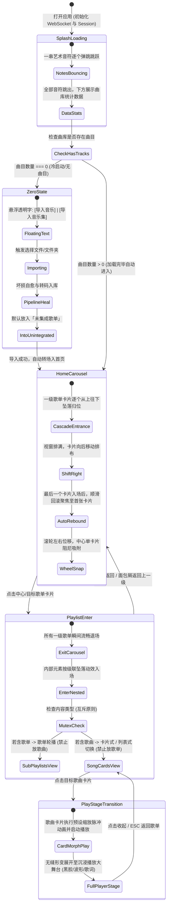

# Wavelet - 前端架构、交互工作流与 UI/UX 详细设计规范

> **设计宗旨**：将 Wavelet 发烧级本地音频引擎、7 类坏损自愈、多歌单 M:N 资产模型与波形打轴能力，与**“跳跃音符启动流、横向吸附轮播、级联坠落回滚动效、层级互斥歌单、INS 纯白极简、纯几何定制 SVG 与弹性物理阻尼”**深度融合，构建生命力十足的视听交互闭环。

---

## 目录
1. [核心交互工作流与全景生命周期 (App Workflow)](#1-核心交互工作流与全景生命周期-app-workflow)
   - [1.1 启动与加载阶段：跳跃艺术音符与数据看板](#11-启动与加载阶段跳跃艺术音符与数据看板)
   - [1.2 冷启动与零曲目状态：纯字悬浮导入与「未集成歌单」](#12-冷启动与零曲目状态纯字悬浮导入与未集成歌单)
   - [1.3 首页：一级歌单横向中心吸附轮播 (Center-Snap Carousel)](#13-首页一级歌单横向中心吸附轮播-center-snap-carousel)
   - [1.4 独创卡片入场动画机：级联自顶坠落与自动回滚 (Drop-Cascade & Auto-Rebound)](#14-独创卡片入场动画机级联自顶坠落与自动回滚-drop-cascade--auto-rebound)
   - [1.5 歌单层级互斥原则与双模展示 (Folder vs Tracks)](#15-歌单层级互斥原则与双模展示-folder-vs-tracks)
   - [1.6 歌曲卡片向播放大舞台的形变转场 (Card-to-Stage Transition)](#16-歌曲卡片向播放大舞台的形变转场-card-to-stage-transition)
2. [全局 INS 纯净视觉系统规范 (Design Tokens)](#2-全局-ins-纯净视觉系统规范-design-tokens)
   - [2.1 调色板：纯白基底与 INS 雅致微彩](#21-调色板纯白基底与-ins-雅致微彩)
   - [2.2 柔和微投影替代机械边框 (Soft Micro-Shadows)](#22-柔和微投影替代机械边框-soft-micro-shadows)
   - [2.3 谷歌圆润可爱字体排印 (Google Fonts Typography)](#23-谷歌圆润可爱字体排印-google-fonts-typography)
   - [2.4 纯几何定制 SVG 矢量图案体系 (Zero Icon-Lib / Zero Emoji)](#24-纯几何定制-svg-矢量图案体系-zero-icon-lib--zero-emoji)
   - [2.5 低文字密度与智能悬停气泡卡片 (Hover Cards)](#25-低文字密度与智能悬停气泡卡片-hover-cards)
   - [2.6 弹性物理弹簧微动效参数 (Spring Physics)](#26-弹性物理弹簧微动效参数-spring-physics)
3. [核心业务模块详细实现原型](#3-核心业务模块详细实现原型)
   - [3.1 启动动画与数据感知看板组件 (SplashView)](#31-启动动画与数据感知看板组件-splashview)
   - [3.2 歌单横向吸附轮播舞台组件 (CarouselStage)](#32-歌单横向吸附轮播舞台组件-carouselstage)
   - [3.3 歌单内部双模展示视图 (PlaylistDetailView)](#33-歌单内部双模展示视图-playlistdetailview)
   - [3.4 播放大舞台与 60fps 贝塞尔流体音波 (PlayerStage)](#34-播放大舞台与-60fps-贝塞尔流体音波-playerstage)
   - [3.5 悬浮底栏超椭圆控制器 (FloatingPlayerDock)](#35-悬浮底栏超椭圆控制器-floatingplayerdock)
4. [全端自适应与弹性布局体系 (Elastic & Responsive Layout)](#4-全端自适应与弹性布局体系-elastic--responsive-layout)
   - [4.1 弹性伸缩侧边栏 (240px 展开态 <-> 72px 胶囊微坞态)](#41-弹性伸缩侧边栏-240px-展开态---72px-胶囊微坞态)
   - [4.2 移动端手势上滑播放抽屉 (Bottom Sheet)](#42-移动端手势上滑播放抽屉-bottom-sheet)
5. [前端工程架构、状态中枢与接口映射](#5-前端工程架构状态中枢与接口映射)
   - [5.1 目录划分与组件解耦 (`packages/frontend/src`)](#51-目录划分与组件解耦-packagesfrontendsrc)
   - [5.2 Zustand 全局响应式状态中枢](#52-zustand-全局响应式状态中枢)
   - [5.3 后端 Session 握手与 WebSocket 实时总线集成](#53-后端-session-握手与-websocket-实时总线集成)

---

## 1. 核心交互工作流与全景生命周期 (App Workflow)



---

### 1.1 启动与加载阶段：跳跃艺术音符与数据看板

#### 1. 艺术音符跳跃动画 (Artistic Notes Bouncing)
- **视觉主体**：使用纯矢量 SVG / Canvas 绘制 5 组纯几何圆润连杆音符（`♪`, `♫`, `♩`, 双符波），无背景、温润石墨色（`#1F2124`）。
- **跳跃时序**：每个音符依次延迟 `100ms` 从基线下方 `y: 24px` 弹性跃起至 `y: -18px`，然后微回弹至自然基线（`stiffness: 450, damping: 18`）。
- **加载态隐喻**：
  - 音符正在逐个弹跳跳出：代表系统正在与后端建立 Local-Session 握手，并拉取曲库元数据。
  - 5 个音符全部跳跃归位完毕：代表数据预热完成，准备下沉浮现数据看板。

#### 2. 淡色曲库数据看板 (Stats Typography)
在音符下方以极柔和、通透的淡石板灰（`#6B7280` / `#A3AAB8`）以 4 行阶梯轻盈浮现：
```
载入了 1,428 首音乐
收录于 16 个歌单
平均单曲时长 03:42
曲库总播放时长 88 小时 16 分钟
```
- **排版参数**：字号 `13px`，行高 `22px`，字重 `500`，字间距 `+0.04em`，配合 `opacity: 0 -> 1` 渐显动效。

---

### 1.2 冷启动与零曲目状态：纯字悬浮导入与「未集成歌单」

#### 1. 零曲目卡点状态 (Zero-State Onboarding)
- 若系统检测到曲目数量为 `0`：
  - 音符完成跳跃后，数据行显示：`曲库尚未载入任何音乐`。
  - 页面不跳转，自然停留在该界面，中央浮现两行**无背景、完全透明、纯粹字体的交互悬浮字**。

#### 2. 纯字无背景悬浮按键 (Pure Floating Text Buttons)
- **两项核心操作**：
  1. **「导入单曲」**：选择单个或多个音频文件（调用系统文件选择器）。
  2. **「导入音乐集」**：选择整个文件夹/专辑目录（递归扫描）。
- **视觉与微交互特效**：
  - **常态**：完全透明无背景，纯文字采用优雅炭黑（`#1F2124`），字号 `16px`，字重 `500`。两按钮间以一枚浅灰微圆点（`·`）隔开。
  - **Hover 特效**：文字轻微上浮 `y: -2px`，底部平滑滑出一条带有轻微弹性阻尼的浅灰胶囊下划线（`scaleX: 0 -> 1`），伴随文字明度微调至纯黑，呼吸感十足。
  - **Click 特效**：点击瞬态缩放 `scale: 0.94`（触感如轻按实体琴键），随后触发原生文件窗口。

#### 3. 特殊歌单：「未集成歌单」动态生命周期
- **默认入库归宿**：无论是单曲导入还是音乐集批量导入，未经用户手动编排的新曲目统一默认进入**「未集成歌单」**（Unintegrated Playlist）。
- **动态显隐规则（不占位设计）**：
  - **显现**：当该歌单内曲目数量 $> 0$ 时，该歌单卡片自动出现在首页轮播的首位，并打上柔和杏仁微光徽标。
  - **消失**：当用户将其内部的歌曲全部整理归入其他自定义歌单后，该歌单内曲目数量变为 `0`，此时**彻底从 UI 树中隐藏，零占位，不留下任何空白缝隙**。
- **转场规则**：导入任务完成并入库成功后，界面平滑过渡，自动推入首页歌单轮播。

---

### 1.3 首页：一级歌单横向中心吸附轮播 (Center-Snap Carousel)

#### 1. 横向舞台与吸附物理学 (Horizontal Snap Physics)
- **视觉构图**：屏幕横向贯穿展示一级歌单大卡片流。视窗中央始终保留一张处于**聚焦态（Active Focus）**的核心卡片。
- **单步位移控制**：鼠标滚轮无论滑动多长距离，最小位移单元均被锁定为**“一张卡片的标准间距（Card Width + Gap）”**。配合 `framer-motion` 的弹性弹簧，滚动停止时自动平滑吸附至最近的中央卡片，杜绝半张卡片悬停在中央的割裂感。
- **焦点卡片视觉层级**：
  - **中心聚焦卡片**：`scale: 1.05`，深层超漫射柔影 `--shadow-hover`，完全清晰展现封面与文字。
  - **两侧边缘卡片**：`scale: 0.92`，透明度 `opacity: 0.55`，微投影减弱，引导视觉焦点高度集中。

---

### 1.4 独创卡片入场动画机：级联自顶坠落与自动回滚 (Drop-Cascade & Auto-Rebound)

为了让歌单入场具备惊艳的物理生命力，卡片出现严格执行以下编排时序：

```
卡片 1 (从上往下坠落入第 1 格)
   │ (延迟 80ms)
卡片 2 (随后从上往下坠落入第 2 格)
   │ (延迟 80ms)
卡片 3、4、5 (依次坠落填充可视视窗)
   │ (视窗充满，视口向右自动滑移推进)
卡片 6, 7 ... N (依次逐个从顶部落入对应格子)
   │ (落入最后一张卡片 N，此时屏幕聚焦于末尾)
平滑惯性回弹 (Auto-Rebound)
   ▼
整列卡片顺畅向右回滚，最终稳稳聚焦于第 1 张卡片！
```

- **下坠物理参数**：`initial: { y: -120, opacity: 0 }`, `animate: { y: 0, opacity: 1 }`，采用弹性弹簧 `{ type: "spring", stiffness: 320, damping: 24 }`。
- **回滚曲线**：到达末张卡片后，停顿 `150ms`，随后触发平滑吸附回滚：`x: endX -> 0`，曲线使用自然缓动 `cubic-bezier(0.25, 1, 0.5, 1)`，耗时 `650ms`。

---

### 1.5 歌单层级互斥原则与双模展示 (Folder vs Tracks)

#### 1. 严格的层级互斥铁律 (Strict Mutual Exclusivity)
Wavelet 采用纯净树形逻辑，杜绝“既有子歌单又有单曲”的混乱形态：
- **目录型歌单（Folder Playlist）**：内部**只能收纳子歌单，绝对禁止放入单首歌曲**。
- **曲目型歌单（Track Playlist）**：内部**只能收纳单首歌曲，绝对禁止放入子歌单**。

#### 2. 点击进入歌单的瞬间转场
- 当用户在轮播中点击目标歌单卡片：
  1. 当前屏幕上所有的一级歌单卡片**以向两侧扩散淡出的方式瞬间流畅退场**（`opacity: 0, scale: 0.95`，耗时 `180ms`）。
  2. 进入新页面后，该歌单内部的子歌单卡片（或歌曲卡片）**再次按上述“自顶向下级联坠落 + 自动回滚”动效优美入场**，形成高度一致的交互韵律。

#### 3. 歌曲型歌单的双模展示切换
对于内部仅含歌曲的歌单，右上角提供一个无背景的纯几何双模切换器：
- **卡片式视图（Card Carousel Mode）**：歌曲以大超椭圆唱片卡片横向排开，滚轮切歌，聚焦单曲。
- **列表式视图（Minimal List Mode）**：极简无边框曲目流，适合快速浏览几百首海量曲目，悬停行浮出轻量播放按键。

---

### 1.6 歌曲卡片向播放大舞台的形变转场 (Card-to-Stage Transition)

- **点击播放动效**：用户在卡片视图点击歌曲卡片时：
  1. 卡片中央立即涌起一次轻微的微缩放脉冲（`scale: 1.0 -> 0.96 -> 1.03`）。
  2. 该卡片利用 `motion` 的 `layoutId="active-track-stage"`，**平滑展开、形变为全屏播放主舞台左侧的黑胶同心圆唱盘**。
  3. 唱针从右上角带阻尼轻缓下落，三次贝塞尔流体波形画布自底向上展开，歌词行垂直居中滑入，实现一气呵成的视听入场。

---

## 2. 全局 INS 纯净视觉系统规范 (Design Tokens)

### 2.1 调色板：纯白基底与 INS 雅致微彩
坚决拒绝脏色、暗黑、高饱和电竞色或过度曝光泛白，通体如同高级生活艺术刊物：

```css
:root {
  /* 基础纯白与温润陶瓷 */
  --bg-canvas: #FFFFFF;            /* 纯净主画布 */
  --bg-surface: #FBFBFC;           /* 卡片与面板底色 */
  --bg-subtle: #F3F4F7;            /* 浅淡次级容器色 */
  --bg-hover: #EEF0F4;             /* 交互高亮浮色 */

  /* 文字墨色 */
  --text-primary: #1F2124;         /* 柔和石墨黑 */
  --text-secondary: #6B7280;       /* 雅致暖灰 */
  --text-muted: #A3AAB8;           /* 极淡烟灰 */

  /* INS 柔和微彩 (占比 < 5%) */
  --accent-blush: #FDF2F4;         /* 柔粉微彩：心动收藏 */
  --accent-sage: #F0F7F4;          /* 鼠尾草微彩：健康与自愈 */
  --accent-lavender: #F4F5FD;      /* 薰衣草淡紫：聚焦卡片光晕 */
  --accent-amber: #FEF7EE;         /* 暖杏橙：未集成歌单徽标 */
}
```

### 2.2 柔和微投影替代机械边框 (Soft Micro-Shadows)
**全面移除所有界面的 `1px` 机械分割线与线框**，空间层次完全依托微投影分离：

```css
--shadow-card: 0 4px 20px -2px rgba(31, 33, 36, 0.035), 0 2px 6px -1px rgba(31, 33, 36, 0.02);
--shadow-hover: 0 14px 34px -4px rgba(31, 33, 36, 0.07), 0 4px 12px -2px rgba(31, 33, 36, 0.025);
--shadow-dock: 0 16px 44px -6px rgba(31, 33, 36, 0.08), 0 6px 18px -3px rgba(31, 33, 36, 0.03);
--shadow-popover: 0 24px 56px -8px rgba(31, 33, 36, 0.10), 0 8px 24px -4px rgba(31, 33, 36, 0.04);
```

### 2.3 谷歌圆润可爱字体排印 (Google Fonts Typography)
- 引入 Google Fonts **`Quicksand`**，笔画末端圆润友好：
  ```css
  @import url('https://fonts.googleapis.com/css2?family=Quicksand:wght@400;500;600;700&display=swap');
  
  body {
    font-family: 'Quicksand', -apple-system, BlinkMacSystemFont, 'Segoe UI', sans-serif;
  }
  ```

---

### 2.4 纯几何定制 SVG 矢量图案体系 (Zero Icon-Lib / Zero Emoji)

**严禁引入第三方图标库与 Emoji**，全站所有操作使用统一的自研几何 SVG：
- **线条粗细**：统一 `1.75px`。
- **线帽与拐角**：统一 `strokeLinecap="round"` 与 `strokeLinejoin="round"`。
- **颜色**：自适应 `currentColor`。

#### 定制几何 SVG 图案集代码规范 (`SvgIcons.tsx`)

```tsx
import type React from 'react';

interface SvgProps {
  className?: string;
}

// 1. 艺术音符群 (用于启动跳跃动画)
export const SvgMusicNote: React.FC<SvgProps & { variant?: 1 | 2 | 3 }> = ({ className = "w-6 h-6", variant = 1 }) => {
  if (variant === 2) {
    // 连杆双音符
    return (
      <svg viewBox="0 0 24 24" fill="none" stroke="currentColor" strokeWidth="1.75" strokeLinecap="round" strokeLinejoin="round" className={className}>
        <path d="M9 18V5l10-2v13" />
        <circle cx="6" cy="18" r="3" fill="currentColor" />
        <circle cx="16" cy="16" r="3" fill="currentColor" />
      </svg>
    );
  }
  // 单音符圆润体
  return (
    <svg viewBox="0 0 24 24" fill="none" stroke="currentColor" strokeWidth="1.75" strokeLinecap="round" strokeLinejoin="round" className={className}>
      <circle cx="8" cy="17" r="3.5" fill="currentColor" />
      <path d="M11.5 17V4c2.5 1.5 5 1.5 6 0" />
    </svg>
  );
};

// 2. 播放按键 (Play) - 纯几何圆角等腰三角形
export const SvgPlay: React.FC<SvgProps> = ({ className = "w-5 h-5" }) => (
  <svg viewBox="0 0 24 24" fill="currentColor" className={className}>
    <path d="M8.5 6.2c0-.9 1-1.5 1.8-1l9.1 5.3c.8.5.8 1.6 0 2.1l-9.1 5.3c-.8.5-1.8-.1-1.8-1V6.2z" />
  </svg>
);

// 3. 暂停按键 (Pause) - 双并排极简胶囊
export const SvgPause: React.FC<SvgProps> = ({ className = "w-5 h-5" }) => (
  <svg viewBox="0 0 24 24" fill="currentColor" className={className}>
    <rect x="7" y="5.5" width="3.5" height="13" rx="1.75" />
    <rect x="13.5" y="5.5" width="3.5" height="13" rx="1.75" />
  </svg>
);

// 4. 侧边栏折叠/展开 (Sidebar Toggle)
export const SvgSidebarToggle: React.FC<SvgProps & { collapsed?: boolean }> = ({ className = "w-5 h-5", collapsed }) => (
  <svg viewBox="0 0 24 24" fill="none" stroke="currentColor" strokeWidth="1.75" strokeLinecap="round" strokeLinejoin="round" className={className}>
    <rect x="3.5" y="4.5" width="17" height="15" rx="4" />
    <path d="M9.5 4.5v15" />
    <path d={collapsed ? "M6 10l2 2-2 2" : "M7.5 10l-2 2 2 2"} />
  </svg>
);

// 5. 视图切换：卡片式 vs 列表式
export const SvgViewSwitch: React.FC<SvgProps & { mode: 'card' | 'list' }> = ({ className = "w-5 h-5", mode }) => (
  <svg viewBox="0 0 24 24" fill="none" stroke="currentColor" strokeWidth="1.75" strokeLinecap="round" strokeLinejoin="round" className={className}>
    {mode === 'card' ? (
      <>
        <rect x="4" y="4" width="7" height="7" rx="2" />
        <rect x="13" y="4" width="7" height="7" rx="2" />
        <rect x="4" y="13" width="7" height="7" rx="2" />
        <rect x="13" y="13" width="7" height="7" rx="2" />
      </>
    ) : (
      <>
        <line x1="4" y1="6" x2="20" y2="6" />
        <line x1="4" y1="12" x2="20" y2="12" />
        <line x1="4" y1="18" x2="20" y2="18" />
      </>
    )}
  </svg>
);

// 6. 心动收录 (Heart) - 超椭圆曲率封闭心形
export const SvgHeart: React.FC<SvgProps & { active?: boolean }> = ({ className = "w-5 h-5", active }) => (
  <svg viewBox="0 0 24 24" fill={active ? "currentColor" : "none"} stroke="currentColor" strokeWidth="1.75" strokeLinecap="round" strokeLinejoin="round" className={className}>
    <path d="M12 20.5S4 14.5 4 8.8A4.8 4.8 0 0112 5.5a4.8 4.8 0 018 3.3c0 5.7-8 11.7-8 11.7z" />
  </svg>
);
```

---

### 2.5 低文字密度与智能悬停气泡卡片 (Hover Cards)
- 界面常态绝不高密度堆叠技术文字。
- 所有详情参数（比特率、采样率、位深、7 类自愈修复原因、操作 Tips）统一由 **`FloatingCard.tsx`** 在鼠标悬停 `120ms` 后平滑浮现。

---

### 2.6 弹性物理弹簧微动效参数 (Spring Physics)
全站拒绝线性动画，统一采用物理阻尼：

```typescript
export const springMotion = {
  // 1. 卡片自顶坠落
  cardDrop: {
    type: "spring",
    stiffness: 320,
    damping: 24,
    mass: 0.85
  },
  // 2. 轮播居中吸附
  carouselSnap: {
    type: "spring",
    stiffness: 280,
    damping: 30
  },
  // 3. 侧边栏弹性收缩
  sidebarSlide: {
    type: "spring",
    stiffness: 260,
    damping: 32
  },
  // 4. 按钮触感微回弹
  buttonTap: {
    scale: 0.94,
    transition: { type: "spring", stiffness: 500, damping: 22 }
  }
};
```

---

## 3. 核心业务模块详细实现原型

### 3.1 启动动画与数据感知看板组件 (`SplashView.tsx`)

```tsx
import React, { useState, useEffect } from 'react';
import { motion, AnimatePresence } from 'framer-motion';
import { SvgMusicNote } from '../common/SvgIcons';
import { springMotion } from '../../assets/styles/motion';

interface SplashStats {
  trackCount: number;
  playlistCount: number;
  avgDurationFormatted: string;
  totalDurationFormatted: string;
}

export const SplashView: React.FC<{
  stats: SplashStats | null;
  onEnterHome: () => void;
  onImportSingle: () => void;
  onImportBatch: () => void;
}> = ({ stats, onEnterHome, onImportSingle, onImportBatch }) => {
  const [notesCompleted, setNotesCompleted] = useState(false);

  useEffect(() => {
    // 5 个音符各间隔 120ms 跳跃，全部跳出耗时 ~800ms
    const timer = setTimeout(() => {
      setNotesCompleted(true);
      // 若已包含歌曲，在展示完数据看板 1200ms 后自动步入首页
      if (stats && stats.trackCount > 0) {
        setTimeout(onEnterHome, 1400);
      }
    }, 850);
    return () => clearTimeout(timer);
  }, [stats, onEnterHome]);

  return (
    <div className="fixed inset-0 bg-[#FFFFFF] flex flex-col items-center justify-center select-none z-50">
      {/* 1. 艺术音符跳跃群 */}
      <div className="flex items-center gap-5 mb-10">
        {[0, 1, 2, 3, 4].map((index) => (
          <motion.div
            key={index}
            initial={{ y: 32, opacity: 0 }}
            animate={{ y: 0, opacity: 1 }}
            transition={{
              ...springMotion.cardDrop,
              delay: index * 0.12,
            }}
            className="text-[#1F2124]"
          >
            <SvgMusicNote className="w-8 h-8" variant={index % 2 === 0 ? 1 : 2} />
          </motion.div>
        ))}
      </div>

      {/* 2. 音符跳出完毕后展现的微文字看板或零曲目导入悬浮字 */}
      <AnimatePresence>
        {notesCompleted && stats && (
          <motion.div
            initial={{ opacity: 0, y: 12 }}
            animate={{ opacity: 1, y: 0 }}
            transition={{ duration: 0.45 }}
            className="text-center"
          >
            {stats.trackCount > 0 ? (
              // 有音乐状态：4 行淡色雅致数据展示
              <div className="flex flex-col gap-2 text-[#6B7280] text-[13px] font-medium tracking-wide">
                <span>载入了 {stats.trackCount} 首音乐</span>
                <span>收录于 {stats.playlistCount} 个歌单</span>
                <span>平均单曲时长 {stats.avgDurationFormatted}</span>
                <span>曲库总播放时长 {stats.totalDurationFormatted}</span>
              </div>
            ) : (
              // 零音乐状态：未载入提示 + 两个纯字无背景悬浮按键
              <div className="flex flex-col items-center">
                <p className="text-[#A3AAB8] text-[13px] mb-8">曲库尚未载入任何音乐</p>

                <div className="flex items-center gap-6">
                  {/* 导入音乐 (单曲) */}
                  <button
                    onClick={onImportSingle}
                    className="relative group bg-transparent border-0 p-0 cursor-pointer text-[#1F2124] text-[16px] font-medium transition-all"
                  >
                    <span>导入音乐</span>
                    <span className="absolute -bottom-1 left-0 w-full h-[2px] bg-[#1F2124] scale-x-0 group-hover:scale-x-100 transition-transform origin-left rounded-full" />
                  </button>

                  <span className="text-[#D1D5DB]">·</span>

                  {/* 导入音乐集 (批量目录) */}
                  <button
                    onClick={onImportBatch}
                    className="relative group bg-transparent border-0 p-0 cursor-pointer text-[#1F2124] text-[16px] font-medium transition-all"
                  >
                    <span>导入音乐集</span>
                    <span className="absolute -bottom-1 left-0 w-full h-[2px] bg-[#1F2124] scale-x-0 group-hover:scale-x-100 transition-transform origin-left rounded-full" />
                  </button>
                </div>
              </div>
            )}
          </motion.div>
        )}
      </AnimatePresence>
    </div>
  );
};
```

---

### 3.2 歌单横向吸附轮播舞台组件 (`CarouselStage.tsx`)

实现滚轮左右滑动、中央单卡片阻尼吸附、自顶坠落级联入场与回滚动画机：

```tsx
import React, { useRef, useState, useEffect } from 'react';
import { motion, useAnimation } from 'framer-motion';
import { springMotion } from '../../assets/styles/motion';
import type { Playlist } from '@wavelet/shared';

interface CarouselStageProps {
  playlists: Playlist[];
  onSelectPlaylist: (playlist: Playlist) => void;
}

export const CarouselStage: React.FC<CarouselStageProps> = ({ playlists, onSelectPlaylist }) => {
  const containerRef = useRef<HTMLDivElement>(null);
  const [activeIndex, setActiveIndex] = useState(0);
  const controls = useAnimation();

  // 1. 卡片级联自顶下落 + 自动回滚时序机
  useEffect(() => {
    async function runEntranceChoreography() {
      // 步骤 A: 聚焦顺次向右推演至末尾
      await controls.start((i) => ({
        y: 0,
        opacity: 1,
        transition: {
          ...springMotion.cardDrop,
          delay: i * 0.08,
        },
      }));

      // 步骤 B: 在末尾卡片稍作定格后，顺滑弹性回滚至第 1 个卡片
      setTimeout(() => {
        setActiveIndex(0);
        if (containerRef.current) {
          containerRef.current.scrollTo({ left: 0, behavior: 'smooth' });
        }
      }, 200);
    }

    runEntranceChoreography();
  }, [controls, playlists.length]);

  // 2. 滚轮横向步进处理 (单次位移吸附)
  const handleWheel = (e: React.WheelEvent) => {
    e.preventDefault();
    if (e.deltaY > 20 && activeIndex < playlists.length - 1) {
      setActiveIndex((prev) => prev + 1);
    } else if (e.deltaY < -20 && activeIndex > 0) {
      setActiveIndex((prev) => prev - 1);
    }
  };

  return (
    <div
      ref={containerRef}
      onWheel={handleWheel}
      className="w-full h-full flex items-center justify-start overflow-x-hidden px-[35vw] select-none"
    >
      <div className="flex items-center gap-10">
        {playlists.map((playlist, index) => {
          const isFocused = index === activeIndex;
          const isUnintegrated = playlist.isDefault && playlist.name.includes('未集成');

          return (
            <motion.div
              key={playlist.id}
              custom={index}
              initial={{ y: -120, opacity: 0 }}
              animate={controls}
              whileHover={{ scale: isFocused ? 1.07 : 0.98 }}
              onClick={() => {
                if (isFocused) {
                  onSelectPlaylist(playlist);
                } else {
                  setActiveIndex(index);
                }
              }}
              style={{
                boxShadow: isFocused ? 'var(--shadow-hover)' : 'var(--shadow-card)',
              }}
              className={`relative flex-shrink-0 w-[280px] h-[380px] rounded-3xl bg-[#FBFBFC] p-6 flex flex-col justify-between cursor-pointer transition-all duration-300 ${
                isFocused ? 'scale-105 opacity-100 z-10' : 'scale-90 opacity-60'
              }`}
            >
              {/* 未集成歌单的暖杏微光小标签 */}
              {isUnintegrated && (
                <div className="absolute top-5 right-5 px-3 py-1 rounded-full bg-[#FEF7EE] text-[#D97706] text-[11px] font-medium tracking-wide">
                  未集成
                </div>
              )}

              {/* 封面四宫格或主封面容器 */}
              <div className="w-full h-[210px] rounded-2xl bg-white shadow-xs overflow-hidden flex items-center justify-center">
                {playlist.coverImagePath ? (
                  
                ) : (
                  <div className="w-16 h-16 rounded-full bg-[#F4F5F7] flex items-center justify-center text-[#A3AAB8]">
                    ♪
                  </div>
                )}
              </div>

              {/* 歌单名称与曲目数量 */}
              <div>
                <h3 className="text-[18px] font-semibold text-[#1F2124] mb-1 truncate">{playlist.name}</h3>
                <p className="text-[13px] text-[#6B7280]">{playlist.trackCount} 首音乐</p>
              </div>
            </motion.div>
          );
        })}
      </div>
    </div>
  );
};
```

---

### 3.3 歌单内部双模展示视图 (`PlaylistDetailView.tsx`)

落实互斥原则与双模切换：
1. **判断歌单内容属性**：
   - 若 `isFolder === true`：内部展示子歌单轮播卡片，**屏蔽任何单曲添加入口**。
   - 若 `isFolder === false`：内部展示曲目，支持**卡片轮播模式**与**极简列表模式**一键切换。
2. **列表模式的无边框轻量行**：
   - 每一行呈现：序号、曲名、艺术家、时长与健康微绿标。
   - 鼠标 Hover 行平滑浮出播放、删除与编辑悬浮小岛。

---

### 3.4 播放大舞台与 60fps 贝塞尔流体音波 (`PlayerStage.tsx`)

1. **同心圆黑胶唱盘**：
   - 播放时驱动 `rotate: 360` 循环旋转（一圈 1.8 秒）。
   - 暂停时触发阻尼减速微动，唱针以弧线抬升复位。
2. **三次贝塞尔流体音波 Canvas**：
   - 消费 64 维频域浮点数组，以 Catmull-Rom 算法实时计算控制点，纯白画布上平滑拟合流体音波。
3. **居中滚动动态歌词**：
   - WebSocket 毫秒级时钟对齐，当前演唱行垂直居中高亮并放大 1.05 倍，点击即 Seek。

---

### 3.5 悬浮底栏超椭圆控制器 (`FloatingPlayerDock.tsx`)

- 居中悬浮脱离底边 `20px`，宽度自适应（大屏 `880px`）。
- 整合：微缩封面、上一曲/播放暂停/下一曲、细微时间轴流体进度槽、Bit-Perfect 直通开关胶囊、音量微滑块与播放队列抽屉。

---

## 4. 全端自适应与弹性布局体系 (Elastic & Responsive Layout)

### 4.1 弹性伸缩侧边栏 (240px 展开态 <-> 72px 胶囊微坞态)
- 展开态（240px）完整呈现品牌、系统根歌单与用户自定义歌单列表。
- 折叠态（72px）平滑收缩，文字隐藏，仅居中展现定制几何 SVG 图标。
- 折叠状态下鼠标悬停任一图标，右侧平滑弹出 `FloatingCard` 提示卡片。

### 4.2 移动端手势上滑播放抽屉 (Bottom Sheet)
- 在移动端/小屏下，侧边栏自动转入底部微型导航胶囊。
- 手指在底部迷你播放条向上滑动时，全屏拉起带有手势跟随与惯性吸附的沉浸式黑胶播放抽屉。

---

## 5. 前端工程架构、状态中枢与接口映射

### 5.1 目录划分与组件解耦 (`packages/frontend/src`)

```
packages/frontend/src/
├── assets/
│   ├── fonts/                     # Quicksand 字体配置
│   └── styles/
│       ├── tokens.css             # 纯白 INS 色彩与柔和微投影变量
│       └── motion.ts              # 弹簧阻尼预设 (springMotion)
├── components/
│   ├── common/
│   │   ├── SvgIcons.tsx           # 全量纯几何定制 SVG (零库/零Emoji)
│   │   └── FloatingCard.tsx       # 悬停才显示的智能气泡提示卡片
│   ├── splash/
│   │   └── SplashView.tsx         # 跳跃音符加载与零曲目纯字导入浮岛
│   ├── carousel/
│   │   └── CarouselStage.tsx      # 横向吸附轮播与坠落回滚动画机
│   ├── playlist/
│   │   ├── PlaylistDetailView.tsx # 歌单内部互斥展示 (卡片/列表双模)
│   │   └── TrackListItem.tsx      # 无边框悬浮交互曲目行
│   ├── player/
│   │   ├── PlayerStage.tsx        # 黑胶同心圆唱盘与全屏大舞台
│   │   ├── FluidWaveform.tsx      # Canvas 2D 60fps 三次贝塞尔音波
│   │   ├── LyricsPanel.tsx        # 居中滚动歌词
│   │   └── FloatingPlayerDock.tsx # 悬浮底栏超椭圆控制器
│   └── layout/
│       └── Sidebar.tsx            # 弹性伸缩侧边栏 (240px <-> 72px)
├── hooks/
│   ├── useWaveletWs.ts            # WebSocket 60fps 频谱与时钟同步
│   └── useHoverDebounce.ts        # 120ms 防抖悬浮卡片控制
├── stores/
│   ├── player.store.ts            # 播放时钟、当前曲目、64 维 FFT 数组
│   ├── library.store.ts           # 歌单树、曲目、未集成歌单动态管理
│   └── ui.store.ts                # 视图路由切换、侧边栏折叠状态
├── services/
│   ├── apiClient.ts               # 带 Session-Token 安全握手的 Fetch 封装
│   ├── track.service.ts
│   └── playlist.service.ts
├── App.tsx                        # 顶层工作流路由编排
└── main.tsx                       # 入口与样式初始化
```

### 5.2 Zustand 全局响应式状态中枢 (`library.store.ts`)

```typescript
import { create } from 'zustand';
import type { Playlist, Track } from '@wavelet/shared';

interface LibraryState {
  playlists: Playlist[];
  currentPlaylist: Playlist | null;
  unintegratedPlaylist: Playlist | null;
  stats: {
    trackCount: number;
    playlistCount: number;
    avgDurationFormatted: string;
    totalDurationFormatted: string;
  };
  
  setPlaylists: (list: Playlist[]) => void;
  setCurrentPlaylist: (pl: Playlist | null) => void;
  refreshStats: () => Promise<void>;
}

export const useLibraryStore = create<LibraryState>((set, get) => ({
  playlists: [],
  currentPlaylist: null,
  unintegratedPlaylist: null,
  stats: {
    trackCount: 0,
    playlistCount: 0,
    avgDurationFormatted: '00:00',
    totalDurationFormatted: '00:00:00',
  },

  setPlaylists: (list) => {
    // 动态提取未集成歌单 (仅当 trackCount > 0 时予以保留与呈现)
    const unintegrated = list.find((p) => p.isDefault && p.trackCount > 0) || null;
    set({ playlists: list, unintegratedPlaylist: unintegrated });
  },

  setCurrentPlaylist: (pl) => set({ currentPlaylist: pl }),

  refreshStats: async () => {
    // 调用 API 实时计算并刷新看板统计数据
  },
}));
```

### 5.3 后端 Session 握手与 WebSocket 实时总线集成

1. **自动安全握手**：客户端首次加载调用 `GET /api/auth/token` 取得密钥，后续所有 REST 请求头自动附带 `x-wavelet-session: <token>`，音频点播流带 `?token=<token>`。
2. **WebSocket 60fps 实时总线 (`/ws/live`)**：
   - `visualizer:fft`：每 16.6ms 直推 64 维频域能量，直接喂入 Canvas 绘制贝塞尔曲线。
   - `playback:sync`：高频对齐当前播放毫秒，校准歌词平滑滚动。
   - `task:progress`：导入转码时实时推送百分比与状态。
