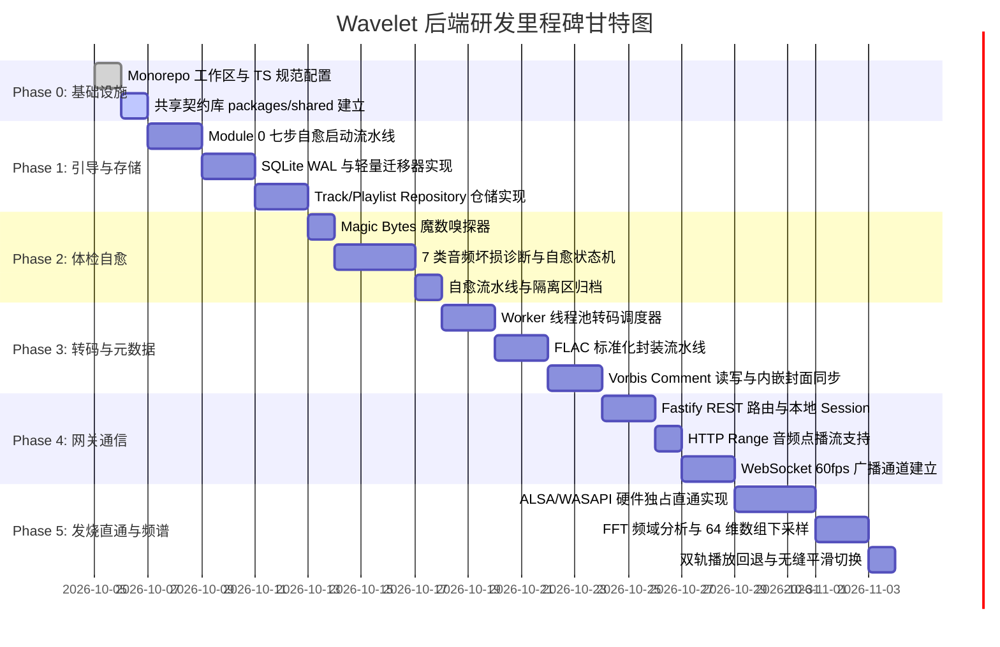

# Wavelet - 后端开发实施路线图 (Roadmap)

## 1. 里程碑时间线

---

## 2. 分阶段实施规划

### Phase 0: 工程基石与 Monorepo 体系初始化
- **工作区配置**：
  - `pnpm-workspace.yaml`：管理 `packages/shared`, `packages/backend`, `packages/frontend`。
  - `tsconfig.base.json`：开启严格模式（`strict: true`, `noImplicitAny: true`）。
  - `biome.json`：配置统一代码规范与格式化。
- **共享契约库 (`packages/shared`)**：
  - `src/types/track.ts`：定义曲目模型与音频参数类型。
  - `src/types/playlist.ts`：定义歌单与 M:N 关联类型。
  - `src/types/health.ts`：定义 7 种坏损类型枚举与诊断报告类型。
  - `src/events/ws.ts`：定义 WebSocket 60fps 频谱包与时钟同步包载荷类型。
  - `src/constants.ts`：系统常量（端口、格式白名单、音质阈值）。
- **交付验收**：`packages/shared` 支持前后端无缝引用并具备完整的 TypeScript 类型推断。

---

### Phase 1: 引导启动与资产持久化内核 (Module 0 & Module 2)
- **启动与生命周期 (Module 0)**：
  - `env-probe.ts`：探测 Node 版本、系统音频驱动与二进制执行权限。
  - `storage-provisioner.ts`：幂等创建 `~/.wavelet/` 目录拓扑（`logs/`, `cache/covers/`, `cache/temp/`, `quarantine/`）。
  - `config-loader.ts`：基于 `zod` 校验 `config.json`，缺失字段安全回退并自动写回。
  - `logger.ts`：挂载 `pino` 双专轨与 `rotating-file-stream`，总容量硬锁死在 30MB 内。
  - `shutdown.ts`：注册 `SIGINT`/`SIGTERM`，安全释放声卡独占句柄、刷盘 WAL 并退出。
- **持久化仓储 (Module 2)**：
  - `db/client.ts`：包装 `better-sqlite3` 单例，启用 WAL 与 NORMAL 模式。
  - `db/migrator.ts`：自研轻量增量迁移器，维护 `_schema_migrations`。
  - `db/schema.sql`：实现 [数据库表设计.md](数据库表设计.md) 中的 6 张表与索引。
  - `repositories/track.repository.ts`：去重索引、CRUD 与搜索。
  - `repositories/playlist.repository.ts`：M:N 关联与浮点排序。
  - `integrity-guard.ts`：物理断链巡检与级联物理清理。
- **交付验收**：首次冷启自动建立目录与数据库结构；人为破坏配置文件可自动补全修复；数据表严格支持 M:N 逻辑关联。

---

### Phase 2: 音频体检与智能自愈引擎 (Module 3)
- **魔数嗅探与类型纠偏**：
  - `sniffer.ts`：基于 `file-type` 探测真实魔数，纠偏后缀伪装，阻断非音频数据。
- **7 类坏损自愈状态机**：
  - `corruption-detector.ts`：输出诊断标志位与详情。
  - `healers/flac-streaminfo-healer.ts`：逆向扫描帧同步字并重构 34 字节 `STREAMINFO`。
  - `healers/frame-align-healer.ts`：滑动窗口定位并截断头部垃圾字节。
  - `healers/crc-interpolator.ts`：埃尔米特插值补偿 CRC-16 损坏帧。
  - `healers/tail-cleaner.ts`：剥除末尾非标准垃圾填充，标准闭合 FLAC 容器。
  - `healers/wav-header-healer.ts`：根据裸 PCM 长度重构标准 44 字节 WAV 头。
  - `pipeline.ts`：流式编排体检、自愈、审计日志写入与隔离区归档。
- **交付验收**：伪装文件精准纠偏；坏损文件经自愈输出合规音频流；不可自愈文件安全转入隔离区。

---

### Phase 3: 标准化 FLAC 转码与元数据打标 (Module 4)
- **多线程转码调度**：
  - `worker-pool.ts`：封装 `node:worker_threads`，并发度绑定 `os.cpus().length - 1`。
  - `transcode.worker.ts`：利用 `ffmpeg-static` 执行标准化封装。
- **转码与封装**：
  - `flac-standardizer.ts`：无损源原样保留采样率与位深；有损源解码封装并标注原编码。
- **元数据读写与同步**：
  - `metadata-writer.ts`：提取标签与高分辨率封面，缓存 500x500 WebP 缩略图；实现 Vorbis Comment 二进制回写器，毫秒级原地更新。
- **交付验收**：转码不阻塞主事件循环；生成的 FLAC 符合官方无损规范；元数据修改不触发音频流重编码。

---

### Phase 4: 网关路由与双向通信传输层 (Module 1)
- **Fastify 网关与安全校验**：
  - `server.ts`：Fastify 实例配置，绑定 `127.0.0.1`。
  - `middleware/session-guard.ts`：校验内存随机生成的 `Local-Session-Key`。
- **REST 控制器**：
  - 曲目管理（`routes/tracks.route.ts`）。
  - 歌单编排（`routes/playlists.route.ts`）。
  - 导入控制（`routes/import.route.ts`）。
  - 偏好设置（`routes/settings.route.ts`）。
- **流式点播与 WebSocket 广播**：
  - `routes/stream.route.ts`：HTTP Range 分块点播支持。
  - `ws/broadcaster.ts`：广播 `fft:data`（60fps）、`playback:sync`（10Hz）与 `task:progress`。
- **交付验收**：REST 接口具备强类型契约；HTTP Range 支持 206 毫秒级 Seek；WebSocket 60fps 广播平稳低延迟。

---

### Phase 5: 发烧级声卡直通与 60fps 频谱引擎 (Module 5)
- **硬件声卡枚举与原生绑定**：
  - `device-manager.ts`：枚举系统硬件物理输出端，获取支持的位深与采样率上限。
- **Bit-Perfect 硬件直通播放管道**：
  - `direct-pcm-player.ts`：直解 FLAC 推送声卡独占句柄（ALSA/WASAPI）；提供 64 位浮点数高精度软件音量调节与启停微淡入淡出。
- **频域分析与贝塞尔点转换**：
  - `fft-pump.ts`：每 16.6ms 截取 1024 样点，经汉宁窗送入 `fft.js` 计算，下采样为 64 维归一化数组推入 WebSocket。
- **双轨调度器**：
  - `playback-router.ts`：无缝在“声卡直通模式”与“HTTP Range Web 回退模式”间切换。
- **交付验收**：打通声卡独占 PCM 数据管道；WebSocket 稳定维持 60 FPS 频域数据推送；播放过程无爆音与杂音。

---

### Phase 6: Web 前端交互引擎与多媒体支撑扩展 (Web Support)
- **启动看板与度量统计**：
  - `routes/stats.route.ts`：秒级单条 SQL 聚合曲目总数、总播放时长与平均时长，支撑 `SplashView` 数据看板。
- **播放队列状态机与模式轮转**：
  - `playback-router.ts`：完整维护 `PlayQueue`，提供切上一曲/下一曲、插队播放、清空及 4 种播放模式（顺序/列表循环/单曲循环/随机乱序）。
- **批量与目录导入体系**：
  - `routes/import.route.ts`：扩展 `POST /api/import/directory` 递归扫描及 `POST /api/import/batch`，多任务进度实时推送。
- **未集成歌单与心动收藏闭环**：
  - 新导入曲目自动归入 `default_unintegrated_tracks`，被分类编排后自动移出；支持 `POST /api/tracks/:id/favorite` 一键收藏。
- **波形概览抽取与前端静态托管**：
  - `waveform-extractor.ts`：抽取 128 点归一化整轨振幅波形并持久化缓存。
  - `server.ts`：集成 `@fastify/static` 自动托管前端生产构建 SPA 应用。
- **交付验收**：全量接口通过集成测试；播放队列切换平滑无杂音；波形与统计查询毫秒级响应。

---

## 3. 交付验收准则 (Definition of Done)

| 维度 | 刚性准则 | 验证要求 |
| :--- | :--- | :--- |
| **类型安全** | 全栈纯 TypeScript，禁止 `any` 与非空断言滥用。 | `pnpm tsc --noEmit` 零报错 |
| **代码规范** | 符合工程规范，无冗余与死代码。 | `pnpm biome check .` 全部通过 |
| **冷启动性能** | 冷启动全流程（环境自愈 + SQLite WAL + 增量迁移）完成时间 $< 200\text{ms}$。 | 启动日志输出耗时达标 |
| **常驻内存** | 空闲待机常驻内存占用 $\le 35\text{MB}$。 | 进程常驻集（RSS）监控达标 |
| **日志安全** | 日志历史备份压缩包严格 $\le 3$ 个，总体积 $\le 30\text{MB}$。 | 磁盘占用空间硬锁死 |
