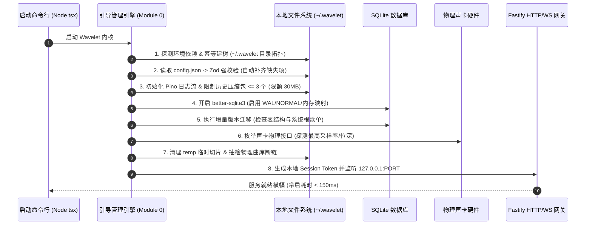
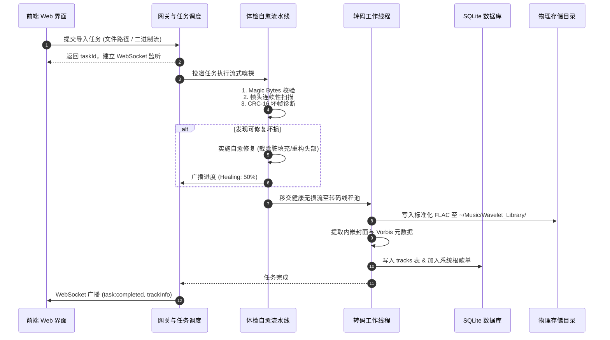
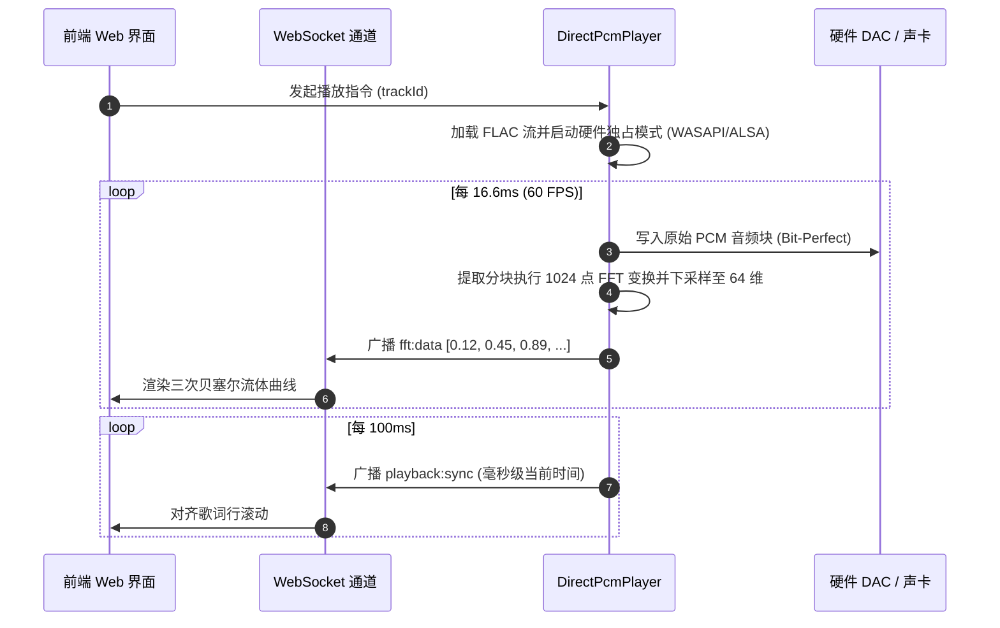

# Wavelet - 后端系统架构设计说明书

## 1. 架构定位与核心原则

Wavelet 后端作为单用户本地运行的音频服务引擎，负责底层硬件声卡驱动、本地文件 IO、嵌入式持久化存储、音频体检自愈流水线与实时数据推送。

### 核心设计原则
1. **轻量与低开销**：冷启动耗时 $< 200\text{ms}$，待机常驻内存 $\le 35\text{MB}$，零外部服务依赖。
2. **本地回环专属**：服务仅监听 `127.0.0.1:<PORT>`，杜绝公网暴露面，结合内存动态生成的一次性会话 Token 校验。
3. **物理与逻辑解耦**：磁盘文件物理单例归档，多歌单收录基于 SQLite 关系表 M:N 逻辑关联。
4. **双轨音频直通**：底层声卡硬件独占直通（Linux ALSA `hw:x,y` / Windows WASAPI Exclusive）保障母带级输出；同时提供本地 HTTP Range Web 流兼容模式。

---

## 2. 系统分层与模块划分

```
Wavelet Backend Engine
├── [Module 0] Bootstrap & Lifecycle Engine (启动初始化与生命周期管理)
│   ├── RuntimeEnvironmentProbe (环境探测与二进制执行权限校验)
│   ├── StorageTopologyProvisioner (~/.wavelet 目录拓扑幂等建树)
│   ├── ConfigHealer (Zod 运行时校验与默认值自愈补齐)
│   ├── MigrationRunner (嵌入式 SQLite WAL 启用与增量迁移)
│   ├── GhostTrackAuditor (磁盘断链巡检与临时切片清理)
│   └── GracefulShutdownSupervisor (声卡独占句柄释放、WAL 刷盘与安全停机)
│
├── [Module 1] Gateway & Transport Layer (网关与传输层)
│   ├── RestController (曲目、歌单、设置 CRUD 与任务控制)
│   ├── AudioStreamer (本地 HTTP Range 音频点播流)
│   ├── HostOriginGuard (防 DNS 重绑定 421 与跨域 Origin 403 校验)
│   ├── SessionGuard (恒定时间 Timing-Safe WS 鉴权与 URL Token 脱敏)
│   └── WebSocketBroadcaster (60fps 频谱帧、播放时钟同步、任务进度)
│
├── [Module 2] Library & Storage Engine (资产管理与持久化核心)
│   ├── SqliteClient (better-sqlite3 包装、WAL 维护)
│   ├── TrackRepository (曲目 CRUD、去重哈希索引、字段锁、复合检索)
│   ├── PlaylistRepository (歌单元数据、M:N 关联与浮点排序权重)
│   ├── LibraryRootRepository (曲库根目录注册与持久化)
│   ├── PathGuard (严格沙箱隔离、多根放行与 dataDir 越权防御)
│   ├── HealedCacheManager (自愈音频确定性缓存与 mtime 联动失效)
│   └── IntegrityGuard (物理断链探测与级联物理回收)
│
├── [Module 3] Audio Inspection & Self-Healing Pipeline (体检自愈流水线)
│   ├── FormatSniffer (Magic Bytes 二进制魔数精准识别)
│   ├── CorruptionDetector (7 种坏损特征诊断状态机)
│   └── HealingExecutor (帧头对齐、STREAMINFO 重建、脏填充切除、坏帧平滑)
│
├── [Module 4] Transcoding & Tagging Engine (标准化转码与打标引擎)
│   ├── WorkerPoolManager (基于 CPU 核心数的并发转码线程池)
│   ├── FlacStandardizer (标准化无损 FLAC 封包输出)
│   └── MetadataWriter (Vorbis Comment 读写、LRC 歌词与内嵌封面同步)
│
└── [Module 5] Bit-Perfect Audio Output Engine (发烧级音频直通引擎)
    ├── DeviceEnumerator (硬件声卡设备枚举与支持格式探测)
    ├── DirectPcmPlayer (ALSA / WASAPI 硬件独占输出管道)
    └── FftVisualizerPump (软件 FFT 频域分析与 64 点归一化数组广播)
```

---

## 3. 通信协议与接口规范

### 3.1 WebSocket 实时广播通道 (`ws://127.0.0.1:23333/ws/live`)

| 事件名称 | 广播频率 | 数据载荷结构 | 说明 |
| :--- | :--- | :--- | :--- |
| 事件名称 | 广播频率 | 数据载荷结构 | 说明 |
| :--- | :--- | :--- | :--- |
| `visualizer:fft` | 60 FPS (~16.6ms) | `number[]` (长度 64，取值 `[0.0, 1.0]`) | 频域能量归一化数组，前端直接作为三次贝塞尔曲线控制点 |
| `playback:sync` | 10 Hz (100ms) | `{ trackId, currentTimeMs, durationMs, state }` | 播放时钟毫秒级对齐，校准歌词滚动与底栏走带 |
| `playback:queue` | 状态变更时 | `{ queue: Track[], currentIndex: number, playMode: string }` | 播放队列与当前播放索引同步广播 |
| `task:progress` | 实时流式 | `{ taskId, fileId, stage, percent, message }` | 导入、体检、自愈、转码任务实时进度反馈 |

### 3.2 HTTP RESTful 核心接口
- **统计看板**：
  - `GET /api/stats`：曲库宏观数据看板聚合（曲目数、歌单数、平均单曲时长与总播放时长，支撑 `SplashView` 秒开）。
- **曲库管理**：
  - `GET /api/tracks`：曲库列表（支持分页、搜索、智能歌单排序过滤 `sort=recent|played|frequent|hires` 与健康状态过滤）。
  - `GET /api/tracks/:id`：曲目元数据详情。
  - `PATCH /api/tracks/:id`：修改曲目元数据。
  - `DELETE /api/tracks/:id`：彻底级联删除曲目实体与物理文件。
  - `GET /api/tracks/:id/cover`：获取曲目内嵌封面（WebP 缩略缓存）。
  - `GET /api/tracks/:id/waveform`：获取整轨 128 点归一化振幅峰值概览（毫秒级绘制走带波形）。
  - `POST /api/tracks/:id/favorite`：一键加入/移出“心动收藏”。
  - `POST /api/tracks/:id/reset-metadata`：重置手动锁定的元数据字段（接收 `{ fields: ('title' | 'artist')[] }`），按当前文件名解析模式回填并清除字段锁定。
- **歌单与分类目录**：
  - `GET /api/playlists/tree`：完整多级嵌套目录树（含父子层级关系）。
  - `GET /api/playlists`：歌单列表（支持 `parentId` 过滤或根歌单过滤）。
  - `POST /api/playlists`：创建歌单或分类目录文件夹（严格互斥约束）。
  - `GET /api/playlists/:id`：歌单详情（支持 `recursive=true` 递归穿透汇总子孙曲目与层级面包屑）。
  - `PATCH /api/playlists/:id`：更新歌单信息或移动目录（防环路死锁保护）。
  - `DELETE /api/playlists/:id`：删除歌单/目录（级联删除子孙节点，不伤物理文件）。
  - `GET /api/playlists/:id/cover` / `POST /api/playlists/:id/cover`：歌单自定义封面存取。
  - `POST /api/playlists/:id/tracks`：向歌单收录曲目（严格互斥：含子歌单或标记为目录则禁止放入；自动从“未集成歌单”移出）。
  - `DELETE /api/playlists/:id/tracks/:trackId`：从指定歌单解除曲目收录。
- **播放中枢与队列控制**：
  - `GET /api/player/status`：获取当前播放引擎综合状态。
  - `POST /api/player/play`：点播单曲（支持 Direct 独占与 Web Audio 流双模）。
  - `POST /api/player/pause` / `resume` / `stop` / `seek` / `volume`：基础回放控制。
  - `GET /api/player/queue`：读取当前播放队列与正在播放索引。
  - `POST /api/player/queue`：设置/替换播放队列。
  - `POST /api/player/queue/add`：下一首插队播放 / 追加至队尾。
  - `DELETE /api/player/queue/:index`：单曲移出播放队列。
  - `DELETE /api/player/queue`：清空未播放队列。
  - `POST /api/player/next` / `previous`：切上一曲 / 切下一曲（结合播放模式计算目标）。
  - `POST /api/player/play-mode`：设置播放模式（`sequence` 顺序 / `repeat-list` 列表循环 / `repeat-track` 单曲循环 / `shuffle` 随机乱序）。
- **音频导入与点播**：
  - `POST /api/import/file`：单文件自愈标准化导入。
  - `POST /api/import/batch`：多文件批量导入。
  - `POST /api/import/directory`：目录文件夹递归批量扫描导入（自动注册为 `imported` 根目录）。
  - `GET /api/import/roots`：获取所有持久化注册的曲库根目录列表（含 `path`, `kind`, `createdAt`）。
  - `DELETE /api/import/roots`：注销曲库根目录（路径经沙箱校验与解绑，根下曲目标记软失效）。
  - `GET /api/stream/:trackId`：本地 HTTP Range 音频点播流（支持 `206 Partial Content` 极速 Seek；透明优先命中 `healed-cache`）。
- **系统设置与审计**：
  - `GET /api/auth/token`：获取单次运行时本地会话认证密钥。
  - `GET /api/settings`：获取运行时配置。
  - `GET /api/inspection-logs`：获取最近坏损自愈审计日志。

---

## 4. 核心子系统架构实现

### 4.1 资产持久化与数据库设计
系统采用嵌入式 SQLite 3，通过 `better-sqlite3` 同步执行，开启 WAL 模式。
详细的数据表字段定义、约束、索引与标准 DDL 参见专注文档：[数据库表设计.md](数据库表设计.md)。

### 4.2 音频体检与自愈状态机

```
Raw File Stream
      │
      ▼
[1. Magic Byte 嗅探] ──── 伪装后缀? ───► [纠偏为真实格式解析]
      │
      ▼
[2. 头部元数据解析] ──── 缺失 STREAMINFO? ───► [逆向扫描重构头部]
      │
      ▼
[3. 连续帧同步字扫描] ── 头部存在垃圾填充? ──► [滑动窗口裁剪脏字节]
      │
      ▼
[4. CRC-16 帧校验] ──── 帧校验失败? ───► [埃尔米特插值平滑补偿]
      │
      ▼
[5. 容器封装校验] ──── 非标准封装? ───► [重封装为标准 FLAC]
      │
      ▼
[标准化健康无损 FLAC]
```

### 4.3 转码并发与双向元数据同步
1. **Worker 线程池**：
   - 线程数量配置为 `Math.max(1, os.cpus().length - 1)`，预留 1 个核心保证 API 响应与播放控制 0 延迟。
2. **转码规范**：
   - 无损源（WAV/ALAC/APE）：原样继承采样率与位深，无损封装至 FLAC。
   - 有损源（MP3/AAC/OGG）：最高精度解码并封装为 FLAC，标签标记 `ORIGINAL_CODEC`。
3. **事务性双写**：
   - 用户编辑元信息或歌词后，立即持久化至 SQLite 数据库（保证前端即时生效），并在后台异步无损重写物理 FLAC 的 Vorbis Header 块。

### 4.4 发烧级硬件音频输出引擎
采用双轨播放架构：
1. **直通模式（Bit-Perfect Direct Output，首选默认）**：
   - Node 进程直解 FLAC 为原始 PCM 缓冲块。
   - 经由原生音频绑定（Linux ALSA `hw:x,x` / Windows WASAPI 独占模式）直接推送至物理声卡。
   - 64 位浮点数高精度软件增益调节音量，绕过系统混音器重采样。
   - 每 16.6ms（60 FPS）截取 1024 个 PCM 样点经 `fft.js` 快速变换，下采样为 64 维数组推入 WebSocket。
2. **Web 回退模式（Browser Audio Fallback）**：
   - 本地 HTTP Range 分块点播，供前端 Web Audio 或远程设备兼容播放。

---

## 5. 核心业务执行时序

### 5.1 启动初始化与自愈流水线时序



### 5.2 导入、体检自愈与入库时序



### 5.3 直通播放与 60fps 频谱同步时序



---

## 6. 本地存储拓扑与沙箱规范

### 6.1 目录结构拓扑

```
~ (用户主目录)
├── .wavelet/                              <-- 系统私有数据目录 (dataDir，严禁注册为曲库根)
│   ├── config.json                        <-- 本地配置 (端口、声卡选择、输出模式)
│   ├── wavelet.db                         <-- SQLite 数据库文件 (WAL 模式)
│   ├── wavelet.db-wal                     <-- SQLite 预写日志
│   ├── logs/                              <-- 结构化日志目录 (最大保留 3 个历史压缩包，总额 <= 30MB)
│   │   ├── wavelet.log                    <-- 系统运行流日志
│   │   └── inspection.log                 <-- 坏损体检自愈专轨日志
│   ├── cache/
│   │   ├── covers/                        <-- 专辑封面缓存 (WebP 格式, 500x500)
│   │   ├── healed/                        <-- 自愈音频确定性缓存 (<file_hash>.flac，mtime 联动失效)
│   │   └── temp/                          <-- 体检修复流临时暂存目录
│   └── quarantine/                        <-- 彻底损坏无法自愈的文件隔离区
│
├── Music/Wavelet_Library/                 <-- 默认系统主托管曲库 (managed 根，用户可见)
│   └── {Artist}/
│       └── {Album}/
│           └── {TrackNumber} - {Title}.flac  <-- 标准化健康的无损 FLAC
│
└── [任意用户外部目录]/                   <-- 原地索引曲库 (imported 根，经沙箱校验注册)
```

### 6.2 路径沙箱隔离规范 (`PathGuard`)
1. **多根放行白名单**：系统通过 `PathGuard` 限制所有音频读写操作仅可在已登记的曲库根 (`library_roots`) 与系统缓存目录 (`cacheDir`) 内进行。未登记根的路径一律抛出 `403 Forbidden`。
2. **私有数据目录禁入约束**：严禁将系统私有数据目录 (`dataDir`，即 `~/.wavelet`) 或其子目录注册为曲库根，防止攻击者利用导入功能越权探测或读取数据库与敏感配置。
3. **真实路径规范化**：所有路径在进入沙箱判定前统一执行 `fs.realpathSync`，消除符号链接（symlink）绕过与 `..` 相对路径穿透攻击。

---

## 7. 网关威胁模型与安全加固规范

作为运行于用户本地的私有音频服务，网关层必须面对跨域恶意网页注入、DNS 重绑定渗透、侧信道计时分析等安全威胁。Wavelet 实现了系统级的防御加固：

### 7.1 防 DNS 重绑定攻击 (Anti-DNS Rebinding)
- **威胁场景**：攻击者控制公网域名并在短时间内修改 DNS 解析记录指向 `127.0.0.1`。受害者在浏览器访问攻击者网页时，页面脚本可能借由攻击者域名发起针对本地 `127.0.0.1:23333` 网关的未授权请求。
- **防御机制** (`HostOriginGuard`)：
  - 对进入网关的所有 HTTP 请求与 WebSocket Upgrade 握手强校验 `Host` 请求头。
  - 回环模式下严格匹配 `127.0.0.1`、`localhost`、`[::1]` 及配置的服务器主机名和端口号。
  - 任何非法、外部或不匹配的 `Host` 头直接阻断并返回 `421 Misdirected Request`。

### 7.2 跨域与 Origin 严格校验
- **威胁场景**：第三方恶意网站通过 `<script>`、`fetch` 或隐藏 `<iframe>` 向本地网关发起 CSRF / 跨站劫持。
- **防御机制** (`HostOriginGuard`)：
  - 检查跨域请求的 `Origin` 请求头。
  - 仅放行同源回环地址（`http://localhost:<PORT>`、`http://127.0.0.1:<PORT>` 等）及受信任前端。非法跨域请求直接拦截并返回 `403 Forbidden`。

### 7.3 恒定时间 WebSocket 鉴权握手 (Timing-Safe Handshake)
- **威胁场景**：逐字符比较认证令牌时，由于字符匹配长度差异引起的响应时间微秒级偏差，可能被攻击者通过统计学侧信道计时攻击还原 Token。
- **防御机制** (`SessionGuard`)：
  - WebSocket 握手时通过 `verifyTokenTimingSafe(provided, expected)` 执行校验。
  - 底层基于 Node.js 原生 `crypto.timingSafeEqual` 对比 Buffer，实现耗时恒定，彻底免疫计时侧信道泄露。

### 7.4 敏感凭证脱敏审计 (URL Token Redaction)
- **威胁场景**：WebSocket 连接常通过 URL Query 带入 `?token=...`。若日志记录完整请求 URL，会导致长期凭证泄露在运行日志、控制台输出或反向代理日志中。
- **防御机制**：
  - 网关日志格式化流中集成敏感参数脱敏拦截器，在请求记录前使用正则对 URL Query 进行清洗，将 `?token=...` 统一脱敏为 `?token=[REDACTED]`。

### 7.5 非回环暴露强密钥门禁 (Non-Loopback Gate)
- **威胁场景**：用户配置不慎将 `host` 修改为 `0.0.0.0` 或局域网物理 IP，导致未设防的服务暴露给整个局域网或公网。
- **防御机制**：
  - 启动阶段探测绑定的监听地址；一旦检测到非回环地址（非 `127.0.0.1` / `localhost` / `::1`），必须显式配置环境变量 `WAVELET_ACCESS_KEY`。
  - 若未设置访问密钥，网关立即阻断启动流程并打印安全告警退出进程，杜绝零鉴权意外裸露公网。
