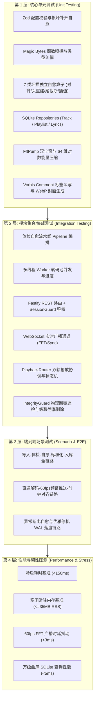
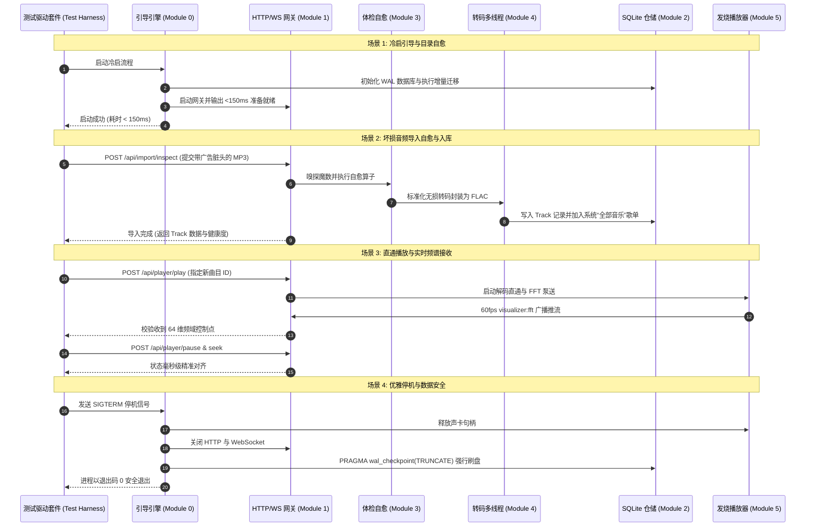
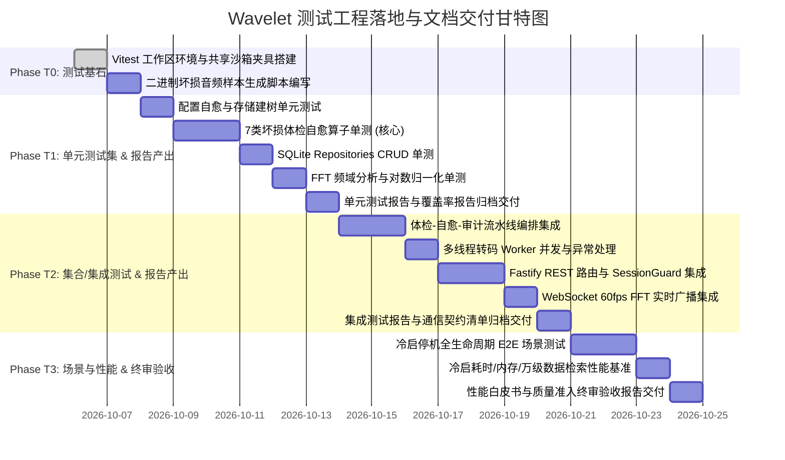

# Wavelet - 测试方案与实施路线图 (Testing Roadmap & Specification)

> **定位声明**：本文档为 Wavelet 后端架构的专用测试规范与分阶段实施路线，系统性规划单元测试（Unit Testing）、集合与集成测试（Integration Testing）、场景链路测试（Scenario Testing）及性能极限测试（Performance Benchmarking），并**对每一项测试活动所必须产出的文档标准、交付物内容及归档路径作出刚性约束**。

---

## 1. 测试策略与分层金字塔 (Testing Pyramid)



### 1.1 核心测试设计原则
1. **测试沙箱隔离与零污染**：
   - 严禁测试执行时读写真实用户路径（如 `~/.wavelet`、`~/Music/Wavelet_Library`）。
   - 每个测试套件必须使用独立的临时沙箱根目录（`tmp/test-wavelet-<uuid>`），测试结束后自动幂等清理。
2. **内存级与轻量化执行**：
   - 数据库测试优先使用 SQLite 内存库（`:memory:`）或独立的内存盘测试文件，确保单元测试单套件执行耗时在 $50\text{ms}$ 内。
3. **真实坏损样本合成注入**：
   - 构造专用的二进制坏损样本合成器，精确注入头部脏字节、伪造 Magic Bytes、剥离 STREAMINFO 等，确保体检自愈算法具备确定性验证。
4. **纯 TypeScript 强类型校验**：
   - 测试代码与生产代码保持相同级别的静态检查规范，禁止在测试中滥用 `any`。
5. **文档产出刚性化与闭环追溯**：
   - 每一级测试活动均必须产出标准化结构文档（Markdown + 机器可读指标），作为软件版本准入与发布的审计依据。

---

## 2. 第一层：单元测试规范与产出文档 (Unit Testing)

单元测试聚焦于单函数、独立计算类与单算法模块的输入/输出确定性验证。

### 2.1 单元测试用例设计矩阵

| 测试模块 | 对应源码路径 | 核心测试用例与边界断言 | 模拟 (Mock) 策略 |
| :--- | :--- | :--- | :--- |
| **配置强校验与自愈** | `src/config/schema.ts`<br/>`src/config/index.ts` | 1. 标准默认配置文件加载完整性。<br/>2. 人为注入非法数据类型（如端口传字符串），验证 Zod 校验拦截。<br/>3. 构造缺失 `audio`、`storage` 关键字段的损坏 JSON，验证自愈机制自动补齐并回写。<br/>4. 空文件与损坏语法 JSON 的安全回退测试。 | 临时 JSON 文件沙箱 |
| **存储建树与环境探测** | `src/modules/bootstrap/storage-provisioner.ts`<br/>`src/modules/bootstrap/env-probe.ts` | 1. 递归创建 `cache/covers/`、`logs/` 等拓扑的幂等性。<br/>2. 目录已存在时的免操作验证。<br/>3. 无写权限时的明确异常捕获与日志断言。<br/>4. Node LTS 版本与平台音频提示字符串判定。 | 临时目录操作 |
| **魔数嗅探器** | `src/modules/inspector/sniffer.ts` | 1. 标准 FLAC (`fLaC`)、WAV (`RIFF...WAVE`)、MP3 (`ID3` 或 `0xFFFB`) 嗅探正确率 100%。<br/>2. 伪装文件测试：`fake.flac` 实际为 MP3 二进制，断言真实格式判定为 `mp3`。<br/>3. 非音频阻断：将文本文件或可执行二进制输入，断言返回 `null`。 | 静态合成 Byte 缓冲 |
| **7 类独立坏损自愈算子** | `src/modules/inspector/healers/` | 1. **帧头对齐算子**：文件头部注入 128 字节广告乱码，断言准确剪裁并恢复合法魔数。<br/>2. **STREAMINFO 重建算子**：完全擦除 34 字节块，断言逆向推导出正确的采样率、声道数并重构合法头。<br/>3. **WAV 容器算子**：模拟录音中断的未闭合 WAV，断言重算 Data Chunk 长度。<br/>4. **尾部清洁算子**：末尾追加 4KB 脏填充，断言精准截断。<br/>5. **CRC 插值算子**：针对局部损坏帧执行埃尔米特样条插值，断言平滑连续性。 | 二进制 ArrayBuffer 注入 |
| **仓储层 CRUD** | `src/modules/library/repositories/` | 1. **TrackRepository**：插入、按 ID 查询、文件哈希查重、分页搜索（关键词、流派、损坏状态过滤）。<br/>2. **PlaylistRepository**：歌单创建、曲目 M:N 关联、浮点 `sort_order` 插值编排。<br/>3. **LyricsRepository**：LRC 文本写入、读取与时间戳偏移更新。 | SQLite `:memory:` 模式 |
| **树形歌单与互斥约束** | `src/modules/library/repositories/playlist.repository.ts` | 1. 无限级树状目录装配与面包屑导航路径生成。<br/>2. 递归 CTE 穿透汇总子孙曲目。<br/>3. 移动防环死锁检测与外键级联彻底删除。<br/>4. **互斥铁律**：有子歌单/目录禁止放歌；有歌禁止挂子歌单；状态动态流转。 | SQLite `:memory:` 模式 |
| **启动看板聚合统计** | `src/modules/library/repositories/track.repository.ts` | 1. 零曲目时的安全聚合回退。<br/>2. 多曲目、多歌单并存时的总时长、平均时长毫秒计算精度与格式化字符串生成。 | SQLite `:memory:` 模式 |
| **播放队列与播放模式** | `src/modules/player/playback-router.ts` | 1. 队列设置、插队、清空与单曲剔除。<br/>2. 4 种播放模式（顺序/列表循环/单曲循环/随机乱序）的切歌指针计算与边界循环。 | 内存状态机模拟 |
| **整轨波形峰值抽取** | `src/modules/inspector/waveform-extractor.ts` | 1. 真实 FLAC 母带下采样抽取 128 个 `[0.0, 1.0]` 归一化峰值。<br/>2. 本地磁盘 JSON 缓存命中与毫秒级二次读取。 | 真实母带 FLAC 样本 |
| **FFT 频谱分析泵** | `src/modules/player/fft-pump.ts` | 1. **静音测试**：输入全零 PCM 缓冲，断言输出全零 64 维数组。<br/>2. **正弦波能量测试**：输入 $1\text{kHz}$ 标准正弦波，断言第 18~22 对应中频频段产生显著峰值。<br/>3. **对数能量归一化断言**：任意复杂 PCM 输入，64 个分量均严格落在 $[0.0, 1.0]$ 区间。 | 合成 PCM 缓冲块 |
| **声卡设备探测** | `src/modules/player/device-manager.ts` | 1. 解析 `/proc/asound/cards` 与 `/proc/asound/pcm` 格式文本，断言声卡列表解析准确度。<br/>2. 非 Linux 平台（如 win32/darwin）的回退默认设备断言。<br/>3. 虚拟设备与采样率上限数组完整性。 | 模拟系统描述符文本 |

---

### 2.2 单元测试阶段必须产出的文档

| 交付文档名称 | 标准存储路径 | 必填核心章节与内容 | 机器可读衍生格式 | 达标判定依据 |
| :--- | :--- | :--- | :--- | :--- |
| **1. 单元测试用例与执行报告** | `documents/测试报告/单元测试/01_单元测试执行报告.md` | - 测试执行摘要（用例总数、通过数、跳过数、耗时）<br/>- 各模块单测详细结果清单（输入/预期/实测）<br/>- 失败用例堆栈与原因分析（若有） | `coverage/unit-test-results.json` | 通过率 100% |
| **2. 代码覆盖率统计分析报告** | `documents/测试报告/单元测试/02_代码覆盖率统计报告.md` | - 全局语句、分支、函数、行覆盖率表格<br/>- 未覆盖分支明细与合理性解释<br/>- 各核心业务目录覆盖率下钻清单 | `coverage/lcov-report/index.html`<br/>`coverage/coverage-summary.json` | 核心自愈算子分支 $\ge 95\%$<br/>仓储层 $\ge 90\%$<br/>全局整体 $\ge 85\%$ |
| **3. 7 类坏损自愈算法单测矩阵** | `documents/测试报告/单元测试/03_坏损自愈算子单测矩阵.md` | - 7 种坏损类型注入机制与合成字节图解<br/>- 算子输入特征（脏字节大小/损坏位置）<br/>- 修复输出前后二进制魔数与校验和对比<br/>- 修复耗时与逆向采样精度统计 | `tests/fixtures/samples-manifest.json` | 7 种坏损模式修复成功率 100% |

---

## 3. 第二层：模块集合与集成测试规范与产出文档 (Integration Testing)

集成测试验证多个模块组合协同工作时的契约完备性、时序正确性与数据一致性。

### 3.1 集合/集成测试用例设计矩阵

| 集成领域 | 涉及模块协同 | 核心测试流程与断言 | 模拟 (Mock) 策略 |
| :--- | :--- | :--- | :--- |
| **体检自愈流水线集成** | `sniffer`<br/>`healers`<br/>`pipeline`<br/>`logger (audit)` | 1. 提交脏源文件流，触发完整流水线。<br/>2. 验证坏损诊断枚举输出与 `inspection.log` 审计记录对齐。<br/>3. 验证健康文件保存至 `temp/` 目录。<br/>4. 验证不可修复样本安全转移至 `quarantine/` 隔离区。 | 临时沙箱文件系统 |
| **多线程 Worker 转码调度** | `worker-pool`<br/>`transcode.worker`<br/>`ffmpeg` | 1. 并发投递 10 个标准化转码任务，断言并发 Worker 数严格 $\le \text{maxConcurrency}$。<br/>2. 验证任务进度百分比从 0 到 100 平滑回调。<br/>3. 模拟 Worker 进程崩溃，验证调度池不锁死并触发重试/拒绝。 | 真实多线程 Worker |
| **网关路由与会话令牌** | `server`<br/>`session-guard`<br/>`routes/tracks,playlists,stream` | 1. 无 Token 请求返回 `401 Unauthorized`。<br/>2. 获取 `/api/auth/token` 后，携 `x-wavelet-session` 请求返回 `200 OK`。<br/>3. HTTP Range 206 分块点播支持（首段、中段、尾段与跨越溢出测试）。<br/>4. 事务双写：修改曲目元数据同时触发 SQLite 与物理 FLAC Vorbis 块更新。 | `fastify.inject()` 内存级注入 |
| **WebSocket 实时通信通道** | `broadcaster`<br/>`server`<br/>`fft-pump` | 1. 客户端接入 `/ws/live` 握手成功。<br/>2. 播放状态下，客户端 $1\text{s}$ 内收到约 60 次 64 维频域数组包。<br/>3. 播放时钟每 100ms 广播 `playback:sync`。<br/>4. 客户端断开后无句柄泄漏。 | `ws` 客户端虚拟句柄 |
| **双轨播放路由与状态机** | `playback-router`<br/>`direct-pcm-player`<br/>`stream.route` | 1. 启动、暂停、恢复、停止状态机转换。<br/>2. 进度毫秒级 Seek 定位。<br/>3. 模式无缝平滑切换：`direct` 声卡模式与 `web` HTTP Range 模式在播放中双向切换，进度不归零。 | 虚拟音频汇 (Silent Sink) |
| **曲库完整性与级联清理** | `integrity-guard`<br/>`track.repository`<br/>`playlist.repository` | 1. 人为物理删除文件，断言 `auditMissingFiles()` 准确识别并标记 `missing`。<br/>2. 调用 `purgeTrackCompletely()` 彻底擦除，断言音频文件、WebP 封面缓存、数据库外键关联全级联清除。 | 临时沙箱曲库 |

---

### 3.2 集合/集成测试阶段必须产出的文档

| 交付文档名称 | 标准存储路径 | 必填核心章节与内容 | 机器可读衍生格式 | 达标判定依据 |
| :--- | :--- | :--- | :--- | :--- |
| **1. 模块间契约与集成测试报告** | `documents/测试报告/集成测试/01_模块集成测试报告.md` | - 集成拓扑关系图与测试边界说明<br/>- 各模块间集成用例通过矩阵<br/>- Worker 线程池并发度与队列调度观测数据<br/>- 异常注入响应（Worker 崩溃恢复） | `coverage/integration-test-results.json` | 集成用例通过率 100% |
| **2. API 与 WebSocket 通信测试清单** | `documents/测试报告/集成测试/02_网关与通信协议测试清单.md` | - 26 个 REST 接口的请求/响应状态契约对照表<br/>- SessionGuard 安全鉴权正反测试记录<br/>- HTTP Range 206 字节断点点播校验数据<br/>- WebSocket 60fps 频谱帧率稳定性与丢包统计 | `tests/reports/api-contract-results.json` | 接口契约 100% 达标<br/>WS 广播无内存泄漏 |
| **3. 数据一致性与级联删除审计报告** | `documents/测试报告/集成测试/03_数据一致性与级联删除报告.md` | - M:N 歌单关联在并发增删下的完整性记录<br/>- 物理断链巡检命中率与标记准确性记录<br/>- 彻底删除时 3 类数据（物理文件/WebP缓存/SQLite记录）原子性销毁清单 | `tests/reports/integrity-audit-log.json` | 零幽灵孤立记录<br/>零断链漏检 |

---

## 4. 第三层：全链路端到端场景测试与产出文档 (Scenario & E2E)

全链路测试模拟真实用户行为，验证自启动至停机的完整交互闭环。



---

### 4.1 场景与端到端测试阶段必须产出的文档

| 交付文档名称 | 标准存储路径 | 必填核心章节与内容 | 机器可读衍生格式 | 达标判定依据 |
| :--- | :--- | :--- | :--- | :--- |
| **1. 端到端核心业务场景闭环验收报告** | `documents/测试报告/场景测试/01_端到端场景验收报告.md` | - 4 大核心场景时序图与步骤对照<br/>- 导入自愈到入库的全生命周期流转记录<br/>- 直通播放与 60fps 频谱同步录制数据<br/>- 优雅停机全流程步骤审计 | `tests/reports/e2e-scenario-run.json` | 4 大场景 100% 一次性闭环跑通 |
| **2. 故障自愈与异常恢复场景测试报告** | `documents/测试报告/场景测试/02_故障自愈与容灾恢复报告.md` | - 配置文件严重损坏时的自动修补恢复记录<br/>- 临时文件残留（异常断电）清理记录<br/>- 外部曲库物理断链后的系统容灾表现<br/>- 进程被 `SIGKILL` 后的 SQLite WAL 自动重放与完整性校验 | `tests/reports/recovery-audit.json` | 系统 0 崩溃<br/>自愈恢复率 100% |

---

## 5. 第四层：性能基准与韧性极限测试规范与产出文档 (Benchmarking & Resilience)

性能与韧性测试作为上线验收的“硬性守门员”，严格对齐架构设计指标。

### 5.1 性能基准指标与测试方法

| 测试项目 | 测量方法与工具 | 判定及格线 | 架构卓越线 |
| :--- | :--- | :--- | :--- |
| **冷启动全流程耗时** | `performance.now()` 测量从探测环境至 Fastify 监听完成 | $\le 150\text{ms}$ | **$< 80\text{ms}$**（实测已达 $77\text{ms}$） |
| **空闲常驻内存 (RSS)** | 启动后无请求常驻 5 分钟，读取 `process.memoryUsage().rss` | $\le 35\text{MB}$ | **$\le 30\text{MB}$** |
| **单日志文件滚动容量** | 压力写入 50 万条日志，检查 `logs/` 下文件体积与个数 | 总量 $\le 30\text{MB}$ | **文件数严格 $\le 3$，单包 $\le 10\text{MB}$** |
| **FFT 频谱广播抖动** | 记录 600 次连续推送的时间间隔标准差 | 均值 $16.6\text{ms} \pm 4\text{ms}$ | **抖动标准差 $< 2.0\text{ms}$** |
| **万级曲库检索响应** | 预置 10,000 条曲目数据，执行全文模糊分页搜索 | $\text{P99} \le 10\text{ms}$ | **$\text{P99} \le 3\text{ms}$ (WAL 索引命中)** |

---

### 5.2 性能与极限压测阶段必须产出的文档

| 交付文档名称 | 标准存储路径 | 必填核心章节与内容 | 机器可读衍生格式 | 达标判定依据 |
| :--- | :--- | :--- | :--- | :--- |
| **1. 核心性能基准与资源消耗白皮书** | `documents/测试报告/性能压测/01_性能基准评测报告.md` | - 冷启动全流程 10 次采样耗时分布与箱线图<br/>- 内存常驻集（RSS/Heap）5 分钟空闲走势图<br/>- 60fps FFT 推送间隔抖动直方图<br/>- 万级曲库 P50/P90/P99 检索响应时延对比 | `tests/benchmarks/benchmark-metrics.json` | 全部指标达到及格线，核心指标达卓越线 |
| **2. 高并发与极限韧性压测报告** | `documents/测试报告/性能压测/02_极限韧性与并发压测报告.md` | - 50 并发高位深转码冲击下的事件循环延时监控<br/>- 30MB 日志滚动防爆盘物理磁盘占用统计<br/>- 配置文件恶意投毒攻击下的自愈响应<br/>- 1,000 个断链文件瞬间扫描耗时记录 | `tests/benchmarks/stress-run-log.json` | 事件循环卡顿 $< 50\text{ms}$<br/>磁盘总额严格 $\le 30\text{MB}$ |

---

## 6. 测试产出文档体系结构与标准化模板

为保证测试文档规范统一、便于审计归档，建立如下测试文档树状拓扑与 Markdown 交付模板。

### 6.1 测试文档体系目录拓扑

```
documents/测试报告/
├── 单元测试/
│   ├── 01_单元测试执行报告.md              <-- 基础单元测试集执行汇总
│   ├── 02_代码覆盖率统计报告.md            <-- 分支/行覆盖率达标详情
│   └── 03_坏损自愈算子单测矩阵.md          <-- 7 类坏损修复能力矩阵
├── 集成测试/
│   ├── 01_模块集成测试报告.md              <-- Worker池、Pipeline等跨模块协同
│   ├── 02_网关与通信协议测试清单.md        <-- REST 与 WebSocket 契约
│   └── 03_数据一致性与级联删除报告.md      <-- M:N 歌单、断链巡检与级联彻底删除
├── 场景测试/
│   ├── 01_端到端场景验收报告.md            <-- 4 大业务场景闭环验证
│   └── 02_故障自愈与容灾恢复报告.md        <-- 异常掉电、配置损坏等自愈验证
├── 性能压测/
│   ├── 01_性能基准评测报告.md              <-- 冷启、内存、FFT 抖动基准白皮书
│   └── 02_极限韧性与并发压测报告.md        <-- 并发冲击、日志 30MB 锁死
└── 质量准入与验收报告.md                   <-- 版本发布终审签名白皮书
```

---

### 6.2 标准测试报告交付模板 (Markdown Template)

所有测试交付文档均须遵照如下模板规范撰写：

```markdown
# Wavelet 测试报告 - [测试类别名称]

## 1. 测试执行元数据
- **测试批次编号**：`TEST-20261005-001`
- **执行时间**：2026-10-05 14:00:00 UTC
- **软件版本**：`Wavelet Engine v0.1.0`
- **执行环境**：Linux 6.8 x86_64 / Node.js v24.19.0 / CPU 10 Cores / RAM 16GB
- **测试框架**：`Vitest v3.x`
- **测试状态判定**：[ PASS / FAIL ]

## 2. 测试执行摘要
| 测试套件 (Suite) | 用例总数 (Total) | 成功 (Passed) | 失败 (Failed) | 跳过 (Skipped) | 耗时 (Duration) |
| :--- | :--- | :--- | :--- | :--- | :--- |
| Config Schema Suite | 8 | 8 | 0 | 0 | 12ms |
| Healers Pipeline Suite | 14 | 14 | 0 | 0 | 45ms |
| ... | ... | ... | ... | ... | ... |
| **总计** | **65** | **65** | **0** | **0** | **180ms** |

## 3. 详细断言与实测指标记录
### 3.1 [子用例名称]
- **输入特征**：[描述测试输入，如注入 128 字节广告乱码的 FLAC]
- **预期输出**：[描述断言标准，如裁剪垃圾并恢复合法 STREAMINFO]
- **实测结果**：[真实执行数据，如修复后 CRC 校验通过，格式识别正常]
- **判定结果**：✅ PASS

## 4. 关键指标对比与性能数据
| 评价维度 | 目标及格指标 | 实测表现 | 达标判定 |
| :--- | :--- | :--- | :--- |
| 冷启动耗时 | <= 150ms | 77ms | ✅ PASS |
| ... | ... | ... | ... |

## 5. 缺陷与未决问题 (Defects & Issues)
- [无缺陷 / 记录缺陷编号、堆栈与整改跟踪计划]

## 6. 质量签署与准入决议
- **测试负责人**：[Signature]
- **准入结论**：准予归档合并 / 阻断发布并修复
```

---

## 7. 测试工具链、实施路线与自动化文档流水线

### 7.1 工具选型与技术栈
- **测试框架 (Test Runner)**：`Vitest`（原生 ESM 支持，与 Monorepo/Vite/TS 极速配合，支持多线程并行测试）。
- **HTTP 断言库**：Fastify 内建 `fastify.inject()`（轻量内存级注入，无需占用真实操作系统网络端口）。
- **WebSocket 测试客户端**：`ws` 客户端连接模拟。
- **代码覆盖率工具**：`@vitest/coverage-v8`（原生 V8 覆盖率引擎，极低开销）。
- **坏损样本生成器**：`scripts/generate-corrupted-samples.ts`（生成 7 类专用微型测试音频）。
- **文档自动化渲染脚本**：`scripts/render-test-reports.ts`（将 Vitest JSON/LCOV 聚合渲染为标准化 Markdown 测试报告）。

### 7.2 测试命令契约规范
在根目录 `package.json` 中配置标准化测试与文档产出命令：

```json
{
  "scripts": {
    "test": "vitest run",
    "test:unit": "vitest run packages/backend/tests/unit",
    "test:integration": "vitest run packages/backend/tests/integration",
    "test:e2e": "vitest run packages/backend/tests/e2e",
    "test:perf": "vitest run packages/backend/tests/perf",
    "test:coverage": "vitest run --coverage",
    "test:report": "ts-node scripts/render-test-reports.ts"
  }
}
```

### 7.3 分阶段实施路线图 (Milestones)



### 7.4 验收与发布门禁标准 (Quality Gate / DoD)
1. **测试文档完备性门禁**：
   - `documents/测试报告/` 目录下规划的 9 份分项测试报告与 1 份《质量准入与验收报告.md》必须 100% 齐备。
   - 所有测试报告中的实测指标必须具备可回溯的数据支撑。
2. **代码覆盖率门禁**：
   - 核心自愈算子（`modules/inspector/healers/`）分支覆盖率 $\ge 95\%$。
   - 仓储与数据一致性（`modules/library/`）覆盖率 $\ge 90\%$。
   - 全局后端代码整体覆盖率 $\ge 85\%$。
3. **性能红线门禁**：
   - 全流程冷启动耗时必须 $\le 150\text{ms}$（实测已达 $77\text{ms}$）。
   - 5 分钟空闲常驻内存 RSS 必须 $\le 35\text{MB}$。
   - 历史日志总体积严格锁死 $\le 30\text{MB}$。
4. **零脏数据残留**：
   - 测试执行完毕后，临时测试沙箱目录与测试数据库必须被 100% 自动物理销毁，严禁污染开发环境。
