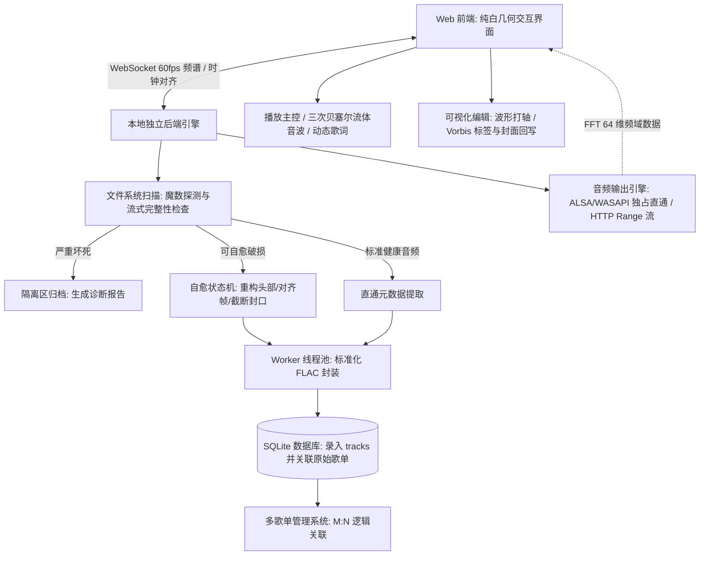

# Wavelet - 详细需求分析说明书

## 1. 业务流程与架构概览

Wavelet 采用 **Web 前端交互（React）+ 本地引擎服务（Node.js / Fastify / SQLite）** 架构。

### 1.1 核心数据流闭环

---

## 2. 模块一：音频导入与破损自愈流水线

### 2.1 导入规格与格式嗅探
1. **输入途径**：支持拖拽单个文件/目录、系统文件选择器递归扫描、本地路径输入。
2. **白名单格式**：`.flac`, `.wav`, `.aac`, `.m4a`, `.ogg`, `.opus`, `.ape`, `.alac`, `.aiff`, `.wma`, `.mp3`, `.webm`。
3. **魔数（Magic Bytes）防伪探测**：
   - 依赖二进制前 32 字节判定真实文件类型（`fLaC`、`ID3`、`RIFF`、`OggS`、`ftypM4A`、`MAC `）。
   - 若文件扩展名与二进制魔数不符，强制按照真实容器解析；非音频文件立即拒绝入库。

### 2.2 7 类可自愈损坏场景与修复规范

| 损坏场景 | 损坏特征 | 自愈机制 | 保真度与修复目标 |
| :--- | :--- | :--- | :--- |
| **1. 容器头 / 元数据块损坏** | ID3v2 长度错误、FLAC `STREAMINFO` 损坏导致常规解码器报错。 | 剥离破损头，向前扫描首个有效音频帧同步字（如 FLAC `0xFFF8`），重新合成标准容器头与采样参数。 | 100% 原始位完美（音频载荷零损耗） |
| **2. 文件尾部意外截断** | 下载中断或断电，末尾缺失 EOF 封口，标称时长与实际大小不符。 | 扫描至最后一个有效音频帧，丢弃尾部不完整碎片，重算 `total_samples` 并封闭容器。 | 99% 完好（保留绝大部分音频，恢复正常播放与 Seek） |
| **3. FLAC MD5 校验和不匹配** | 标签编辑软件误操作导致元数据 MD5 与实际解压校验不一致。 | 对全文件音频流进行安全解码，重新计算 128-bit MD5 并写回 `STREAMINFO`。 | 100% 原始位完美 |
| **4. WAV / AIFF RIFF 块长度错误** | 录音未闭合导致 `RIFF size` 或 `data chunk size` 为 0 或 `0xFFFFFFFF`。 | 依据物理文件大小反算实际载荷：`data_size = file_size - header_size`，修正 4 字节长度字段。 | 100% 原始位完美 |
| **5. M4A / ALAC `moov` 原子缺失** | Apple 容器中索引表 `moov` 丢失或 chunk offset 错位。 | 扫描 `mdat` 音频数据块边界，提取帧边界重建 `stsz/stco/stsc` 采样描述并将 `moov` 前置优化。 | 100% 原始位完美 |
| **6. 格式伪装与扩展名冲突** | 将 MP3/AAC 强行改后缀为 `.flac` 或 `.wav`。 | 魔数检测识别真实编码流后，执行无损解复用（Demux），重新封装转码为标准化 FLAC。 | 100% 保留原始编码流质量 |
| **7. 中间孤立坏帧 / 数据位翻转** | 存储坏道导致个别音频帧损坏，播放产生爆音或中断。 | 丢弃损坏单帧（10~25ms），在前后正常音频帧间施加 15ms 交叉淡入淡出插值。 | 消除尖锐爆音，听感平滑连续 |

### 2.3 不可逆坏死判定与隔离
- **判定条件**：
  1. 0 字节文件或全文件由单调字节（`0x00`/`0xFF`）填充。
  2. 物理数据丢失 > 50% 且无法找到任何有效音频同步字。
  3. 受专有商业 DRM 锁定的加密文件。
- **处理规范**：终止处理并移入 `~/.wavelet/quarantine/`，在界面生成带错误码的诊断条目，支持一键在文件管理器中定位源文件。

---

## 3. 模块二：标准化 FLAC 转码与元数据重构

### 3.1 转码策略
1. **健康 FLAC 直通**：输入文件已是合规无损 FLAC 时，跳过重新转码，仅做元数据提取与文件哈希索引。
2. **无损源格式（WAV / ALAC / APE / AIFF）**：保持原始采样率（最高支持 192kHz）和位深（16/24/32-bit），无损封装为标准化 FLAC。
3. **有损源格式（MP3 / AAC / OGG / OPUS / WMA）**：解码后封装至 FLAC 容器，并在数据库与标签中明确标注原始编码（如 `ORIGINAL_CODEC=MP3`），杜绝多次有损重压缩。

### 3.2 元数据与封面迁移
- **标签映射**：提取 `TITLE`, `ARTIST`, `ALBUM`, `ALBUMARTIST`, `DATE`, `GENRE`, `TRACKNUMBER`, `DISCNUMBER` 并写入目标 FLAC Vorbis Comments。
- **歌词内嵌**：源文件的内嵌歌词（如 ID3 USLT/SYLT 或 Vorbis `LYRICS`）同步写入新 FLAC。
- **封面处理**：提取原始封面图像，以 `METADATA_BLOCK_PICTURE` 规范嵌入；同时在 `~/.wavelet/cache/covers/` 生成 500x500 WebP 缩略缓存。

### 3.3 并发与调度控制
- 基于 Node.js `worker_threads` 并发执行转码，最大并行度绑定 CPU 核心数（默认 `os.cpus().length - 1`）。
- 播放期间自动降低 Worker 线程优先级，保障播放控制与音频渲染零延迟。

---

## 4. 模块三：曲库中枢与多歌单管理

### 4.1 数据模型与存储架构
采用物理文件单例存储，逻辑歌单通过 SQLite 建立 M:N 多对多关联。详细表结构与字段定义参见文档：[数据库表设计.md](../数据库表设计.md)。

### 4.2 歌单管理规范
1. **系统根歌单（原始歌单 / 全部音乐）**：
   - 系统预置，`is_default = 1`，不可重命名、置底或删除。
   - 所有成功入库的曲目 100% 自动汇入此歌单。
2. **自定义歌单**：
   - 支持创建、重命名、自定义封面、侧边栏拖拽调序。
   - 支持通过浮点数权值 `sort_order` 在歌单中调整曲目顺序。
3. **智能歌单动态视图**：
   - **最近添加**：按入库时间戳倒序。
   - **最近播放**：按 `last_played_at` 倒序。
   - **最常收听**：按 `play_count` 倒序。
   - **Hi-Res 母带**：筛选 `sample_rate >= 88200` 或 `bit_depth >= 24` 的曲目。
4. **导入与导出**：
   - 支持将歌单导出为标准 UTF-8 编码的 `.m3u` / `.m3u8` 文件。
   - 支持导入外部 `.m3u` 文件，根据相对路径、文件名与文件哈希匹配本地曲目。

---

## 5. 模块四：播放主控与音频引擎

### 5.1 纯白几何视觉规范
- **色彩规范**：
  - 主画板背景：`#FFFFFF`
  - 次级卡片与侧边栏：`#F8F9FA`
  - 分割线与细边框：`#E9ECEF` / `rgba(0, 0, 0, 0.06)`
  - 主文字：`#18181B`（石墨黑）
  - 辅助文字：`#71717A`（中灰）
  - 聚焦微高亮：`#27272A`
- **几何与动效参数**：
  - 唱片转盘：正圆几何（`rounded-full`），播放时以 33⅓ RPM 角速度连续匀速旋转。
  - 控件与面板：连续曲率超椭圆（Squircle，`rounded-2xl`）。
  - 栅格布局：播放舞台（唱片、封面、参数）与歌词面板严格呈 1:1.618 黄金分割排布。
  - 频谱波形：基于 64 维频域数据通过三次贝塞尔曲线连续拟合，平滑透明灰填充。
  - 动效曲线：自然阻尼缓动（`cubic-bezier(0.16, 1, 0.3, 1)`）。

### 5.2 播放回放管线（双模架构）
1. **发烧直通模式（Bit-Perfect Direct Output，首选默认）**：
   - 后端使用 Node 原生音频驱动绑定（Linux ALSA `hw:x,y` / Windows WASAPI Exclusive 独占模式），直接输出原始 PCM 数据块。
   - 绕过操作系统混音器的强制 48kHz 重采样，保持 96kHz/192kHz/24bit 母带精度。
   - 后端每隔 16.6ms（60 FPS）对 1024 样点做 FFT 变换并下采样为 64 维数组，通过 WebSocket 推送至前端绘制流体波形。
2. **Web 流式兼容模式（Web Streaming Mode）**：
   - 后端提供带 `Content-Range` 的 HTTP 点播流，前端通过 Web Audio API 播放，适用于局域网或远程设备。
3. **播放控制能力**：
   - 无缝播放（Gapless Playback）。
   - 切歌/启停微淡入淡出（150ms~300ms）消除爆音。
   - 播放模式：顺序播放、列表循环、单曲循环、随机乱序播放。
   - 播放队列：支持拖拽排序、插队播放、单曲移除、一键清空未播项。

---

## 6. 模块五：可视化元信息与歌词编辑

### 6.1 歌词打轴同步器
1. **波形辅助走带**：展示整轨波形概览轨道与走带指针。
2. **听歌打轴**：支持按 `Space` 或 `Enter` 键记录当前播放指针为当前歌词行时间戳并自动步进。
3. **时间轴拖拽微调**：支持直接在波形轨道上拖拽歌词锚点，以毫秒精度对齐音频峰值。
4. **双向写回与导出**：支持导出外部 `.lrc` 文件，或直接将 LRC 文本无损回写至 FLAC 的 Vorbis `LYRICS` 字段。

### 6.2 标签与封面编辑器
1. **字段修改**：可视化编辑曲名、艺术家、专辑、流派、年份、音轨号、碟号。
2. **封面更新**：支持拖拽替换图片、1:1 正方形裁剪、原图导出。
3. **批量处理**：多选曲目批量修改专辑/流派/年份，支持按模式（如 `%artist% - %title%`）自动解析填充。
4. **无损安全回写**：仅重构 FLAC 头部 Metadata Blocks，不重新编码音频数据块，毫秒级原地更新。

---

## 7. 系统健壮性与边界防护规范

### 7.1 外部移动与断链重连
- 物理文件被外部重命名或移动时，系统不删除数据库记录，将 `tracks.health_status` 设为 `'missing'`。
- 用户指定新目录或触发重连时，系统根据音频时长、采样率与文件 SHA-256 哈希自动匹配并批量刷新物理路径。

### 7.2 级联清理与缓存垃圾回收
- **普通歌单移除**：仅删除 `playlist_tracks` 关联，不触动物理文件与主库。
- **根歌单彻底删除**：经防呆确认后，原子级删除关联引用、外置歌词与物理 FLAC 文件，并回收无引用的专辑封面缓存。

### 7.3 自愈修复版本回滚
- 自愈修复时默认生成 `.corrupted.bak` 原始副本。
- 允许用户在详情面板一键撤销自愈并恢复原始备份文件；试听确认无误后提供一键清除备份释放磁盘空间。
